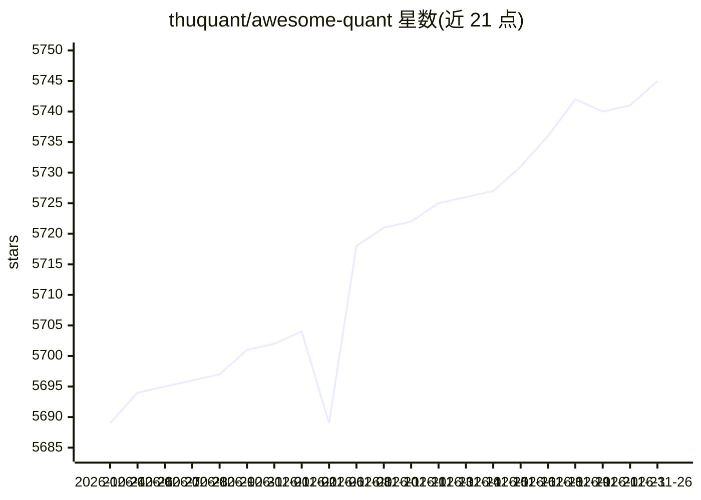

# thuquant/awesome-quant

⭐ 5,745 · MIT · 推送 2026-11-25 · [GitHub](https://github.com/thuquant/awesome-quant) · 组织维护 · 中文 README

**面向量化从业者的中文 Quant 资源索引清单**

以 Markdown 清单形式组织中文量化资源，覆盖数据源、数据库、量化交易平台、策略与因子研究、回测框架、交易 API、Python/R/C++/Julia 编程资源、论坛、书籍、论文与国内监管政策链接。条目附一句话说明，并标注收费/免费属性；收录大量国内平台（聚宽、米筐、掘金、优矿等）与近期新增的 MCP 服务器、AI Agent 相关量化工具条目。本体为资源索引，不含安装与运行说明。

## 筛选速览

| 维度 | 判定 | 备注 |
|---|---|---|
| AI 角色 | `ai-knowledge` | 知识聚合/清单类 |
| 许可风险 | `permissive` | MIT |
| 部署形态 | `library` | 以包/库形式分发 |
| 模型依赖 | — | README 未给出锁定关系 |
| 硬件要求 | — | 无带数字的原话,不猜 |
| 安装摩擦 | `low` | 无编译、无系统依赖或容器化 |
| 成熟度 | — | 结构信号不足 |

## 能力要点

- 按数据源/回测/交易API/编程/书籍/论文等十余个分类组织
- 收录国内量化平台与数据接口（TuShare、AkShare、聚宽、米筐等）
- 标注各数据源的收费/免费属性
- 含 MCP 服务器与 AI Agent 量化工具条目

## 适用场景

- 查找中国市场的量化金融数据接口
- 收集 A 股相关的回测框架与交易 API
- 入门量化交易时检索中文教程、书籍与社区

## 场景标签

`金融量化` `精选清单` · 领域:学习与行业

## 证据(README 行号)

> L1: # Awesome Quant Awesome
> L3: 一份精心挑选的中文Quant相关资源索引。
> L244: # 其他Quant资源索引

## 星数曲线

2026-10-24 5,689 → 2026-11-26 5,745（+56）

---
*卡片 v1 · prompt 1.4 · 生成 2026-11-22 · 置信度 mid · 依据 README sha `a73a30b92c1c` · [字段定义](../../DATASET.md)*
