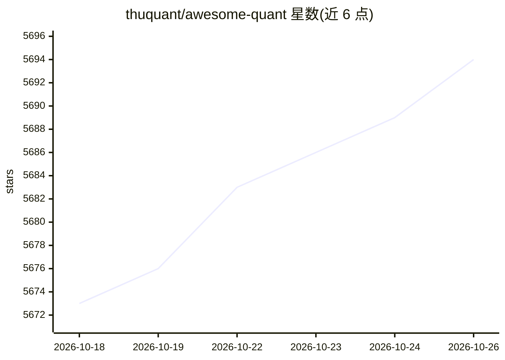

# thuquant/awesome-quant

⭐ 5,694 · MIT · 推送 2026-10-21 · [GitHub](https://github.com/thuquant/awesome-quant) · 组织维护 · 中文 README

**中文 Quant 资源索引：数据源/平台/回测/交易 API 等分类清单**

由 thuquant 维护的中文量化资源策展清单，按数据源、数据库、量化交易平台、策略、回测、交易 API、编程语言（Python/R/C++/Julia）、论坛、书籍、论文、信息源与监管政策等类别组织条目，收录 TuShare、vnpy、QUANTAXIS、QuantLib 等项目及聚宽/米筐/掘金等平台，并链接英文版 awesome-quant 与其他 Awesome 列表。面向量化研究与交易从业者提供资源查找入口，本身不提供可运行代码，条目随生态更新。

## 筛选速览

| 维度 | 判定 | 备注 |
|---|---|---|
| AI 角色 | `ai-knowledge` | 知识聚合/清单类 |
| 许可风险 | `permissive` | MIT |
| 部署形态 | `library` | 以包/库形式分发 |
| 模型依赖 | — | README 未给出锁定关系 |
| 硬件要求 | — | 无带数字的原话,不猜 |
| 安装摩擦 | `low` | 无编译、无系统依赖或容器化 |
| 成熟度 | — | 结构信号不足 |

## 能力要点

- 按数据源/平台/回测/交易API 等十余个类别组织的策展清单
- 覆盖 Python/R/C++/Julia 四种语言的量化相关库与教程
- 收录中国市场监管机构、交易所与中文社区信息源
- 链接英文版 awesome-quant 等其他索引

## 适用场景

- 查找中文财经数据源与量化平台
- 对比选型回测框架与交易 API
- 系统学习量化相关的编程、书籍与论文资源

## 场景标签

`精选清单` `金融量化` · 领域:学习与行业

## 证据(README 行号)

> L3: 一份精心挑选的中文Quant相关资源索引。
> L7: ## 数据源

## 星数曲线

2026-10-18 5,673 → 2026-10-26 5,694（+21）

---
*卡片 v1 · prompt 1.4 · 生成 2026-10-20 · 置信度 mid · 依据 README sha `2c40e74f194c` · [字段定义](../../DATASET.md)*
