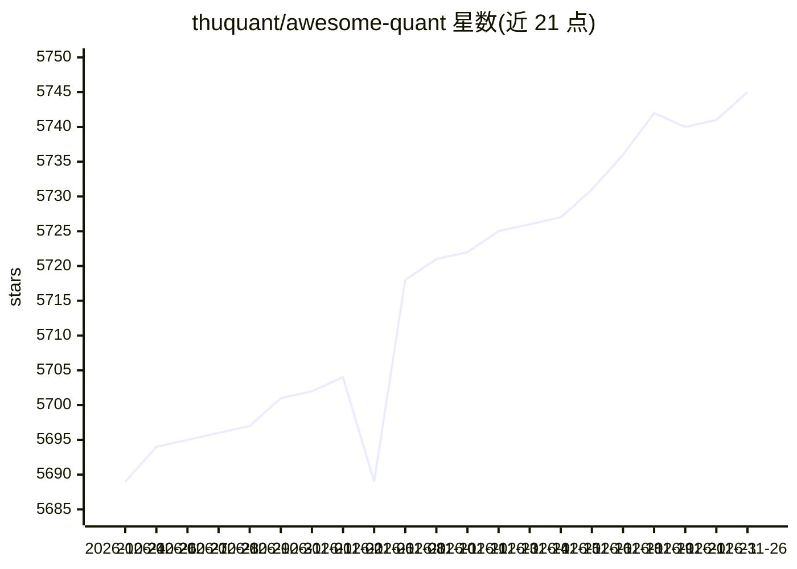

# thuquant/awesome-quant

⭐ 5,745 · MIT · 推送 2026-11-25 · [GitHub](https://github.com/thuquant/awesome-quant) · 组织维护 · 中文 README

**中文量化金融资源索引：数据、平台、回测、学习资料一站汇总**

一份精选的中文量化（Quant）相关资源链接索引，按数据源、数据库、量化交易平台、策略、因子研究、回测、交易API、编程语言（Python/R/C++/Julia）、论坛、书籍、论文、信息源与政策等章节组织。条目以外部链接加中文简介形式呈现，覆盖免费与收费数据接口、国内外在线量化平台、开源回测框架与交易组件，并含 Python/R 的安装与教程子节。作为清单本身不提供代码安装方式，仅收录第三方资源。

## 筛选速览

| 维度 | 判定 | 备注 |
|---|---|---|
| AI 角色 | `ai-knowledge` | 知识聚合/清单类 |
| 许可风险 | `permissive` | MIT |
| 部署形态 | `library` | 以包/库形式分发 |
| 模型依赖 | — | README 未给出锁定关系 |
| 硬件要求 | — | 无带数字的原话,不猜 |
| 安装摩擦 | `low` | 无编译、无系统依赖或容器化 |
| 成熟度 | — | 结构信号不足 |

## 能力要点

- 按数据源、平台、回测、交易API、编程等约15个章节组织的链接清单
- 收录 TuShare/AkShare/RQAlpha/QUANTAXIS/Hikyuu 等中文量化生态开源项目
- 含 Python、R、C++、Julia 四种语言的教程与库资源子节
- 提供论文子清单 awesome-quant/papers.md

## 适用场景

- 入门量化时查找中文数据接口和回测框架
- 比较国内外在线量化交易平台
- 系统检索量化领域书籍、论文与社区论坛

## 场景标签

`精选清单` `金融量化` · 领域:学习与行业

## 证据(README 行号)

> L1: # Awesome Quant Awesome
> L3: 一份精心挑选的中文Quant相关资源索引。
> L5: ## 目录

## 星数曲线

2026-10-24 5,689 → 2026-11-26 5,745（+56）

---
*卡片 v1 · prompt 1.4 · 生成 2026-11-26 · 置信度 mid · 依据 README sha `44c8d40a8608` · [字段定义](../../DATASET.md)*
