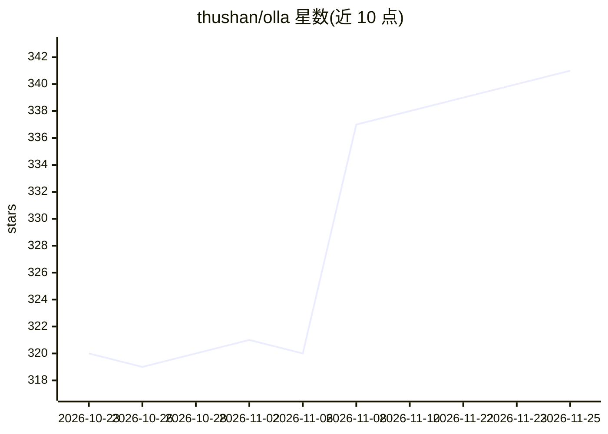

# thushan/olla

⭐ 341 · Go · Apache-2.0 · 推送 2026-11-24 · [GitHub](https://github.com/thushan/olla) · [官网](https://tensorfoundry.io/products/olla) · 个人维护

**自托管 LLM 基础设施的代理与负载均衡器：路由、故障转移、统一模型目录**

用 Go 编写的轻量代理与负载均衡器，面向自托管 LLM 推理后端：提供优先级路由、自动故障转移、连接重试、KV-cache 感知的粘性会话、模型发现与统一目录、健康检查与熔断。支持 OpenAI 与 Anthropic 两种 API 路径（透传或自动转换格式），内嵌只读管理面板。运行时内存低于 50Mb，提供安装脚本、Docker 镜像、go install 与源码构建方式。云 API 需经 LiteLLM 桥接，本体不代理托管云服务。

## 筛选速览

| 维度 | 判定 | 备注 |
|---|---|---|
| AI 角色 | `ai-ecosystem` | LLM/agent 周边工具 |
| 许可风险 | `permissive` | Apache-2.0 |
| 部署形态 | `self-host` | docker 或自建部署 |
| 模型依赖 | local-ok | 支持本地模型 |
| 硬件要求 | — | 无带数字的原话,不猜 |
| 安装摩擦 | `low` | 无编译、无系统依赖或容器化 |
| 成熟度 | — | 结构信号不足 |

## 能力要点

- 双代理引擎：Sherpa（简单）与 Olla（含熔断、连接池）
- 原生支持 Ollama、vLLM、llama.cpp、SGLang、LM Studio 等 13 类后端
- Anthropic Messages API 透传或 OpenAI 格式自动翻译
- 内嵌只读管理面板，二进制内直接提供

## 适用场景

- 家庭实验室里在多台机器的 Ollama 实例间做负载均衡
- 团队本地端点与云 API 混合部署的统一路由
- 让 Claude Code 等 CLI 工具通过本地模型运行
- 企业 GPUStack 集群与 vLLM 服务器的接入层

## 场景标签

`模型网关` · 领域:Agent 开发

## 证据(README 行号)

> L28: Olla is a high-performance, low-overhead, low-latency proxy and load balancer for managing LLM infrastructure. It i
> L70: Olla proxies the following self-hosted inference backends. The **Anthropic API** column shows whether `/olla/anthro

## 星数曲线

2026-10-23 320 → 2026-11-25 341（+21）

---
*卡片 v1 · prompt 1.4 · 生成 2026-11-25 · 置信度 high · 依据 README sha `ac01f757a89e` · [字段定义](../../DATASET.md)*
