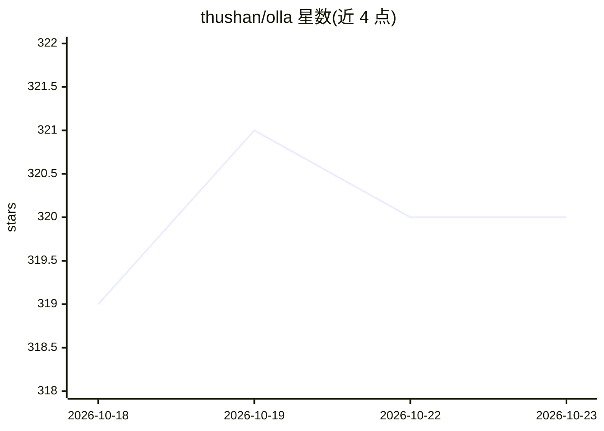

# thushan/olla

⭐ 320 · Go · Apache-2.0 · 推送 2026-10-16 · [GitHub](https://github.com/thushan/olla) · [官网](https://tensorfoundry.io/products/olla) · 组织维护

**自托管 LLM 推理后端的代理与负载均衡器**

用 Go 编写的 LLM 基础设施代理与负载均衡器：跨本地/远程推理后端（Ollama、vLLM、llama.cpp、LM Studio、SGLang 等 11 类）做优先级路由、自动故障转移与统一模型发现。提供 OpenAI 与 Anthropic 两种 API 形态（透传或格式转换），含 KV-cache 亲和的粘性会话、熔断器、嵌入式只读管理面板，运行内存低于 50Mb。定位为与 LiteLLM 等 API 网关配合使用，面向自建 GPU 集群与家庭实验室场景。

## 筛选速览

| 维度 | 判定 | 备注 |
|---|---|---|
| AI 角色 | `ai-ecosystem` | LLM/agent 周边工具 |
| 许可风险 | `permissive` | Apache-2.0 |
| 部署形态 | `self-host` | docker 或自建部署 |
| 模型依赖 | local-ok | 支持本地模型 |
| 硬件要求 | — | 无带数字的原话,不猜 |
| 安装摩擦 | `low` | 无编译、无系统依赖或容器化 |
| 成熟度 | — | 结构信号不足 |

## 能力要点

- 11 类后端原生接入（Ollama/vLLM/llama.cpp/LM Studio/SGLang 等）
- 优先级路由、自动故障转移、熔断器与自愈式模型发现刷新
- Anthropic Messages API 透传或 OpenAI 格式自动转换
- 二进制内嵌只读管理面板，运行内存低于 50Mb

## 适用场景

- 多个 Ollama/vLLM 实例间做负载均衡与故障转移
- 让 Claude Code 等 CLI 工具接入本地模型
- 通过 LiteLLM 桥接本地端点与云 API 的混合部署

## 场景标签

 · 领域:LLM 基础设施/推理网关

## 证据(README 行号)

> L28: Olla is a high-performance, low-overhead, low-latency proxy and load balancer for managing LLM infrastructure. It i
> L30: Olla works alongside API gateways like LiteLLM or orchestration platforms like GPUStack, focusing on making your **

## 星数曲线

2026-10-18 319 → 2026-10-23 320（+1）

---
*卡片 v1 · prompt 1.4 · 生成 2026-10-21 · 置信度 high · 依据 README sha `63bd2738a6bc` · [字段定义](../../DATASET.md)*
