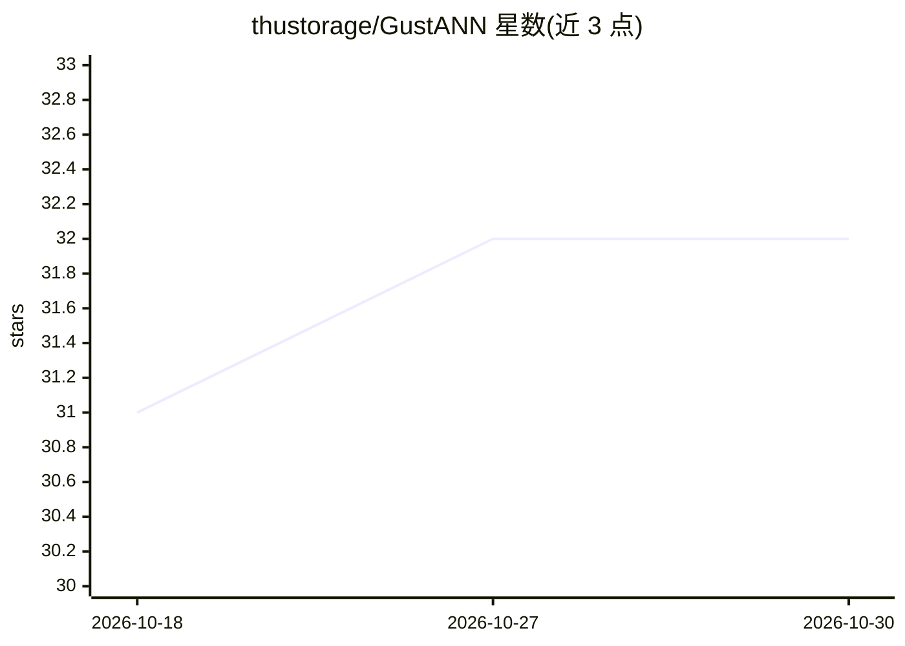

# thustorage/GustANN

⭐ 32 · Cuda · 推送 2026-10-20 · [GitHub](https://github.com/thustorage/GustANN) · 组织维护 · 中文 README

**单 GPU 十亿级向量检索引擎：SSD/内存/显存多模式**

清华大学存储团队发表的 SIGMOD'26 论文配套系统：基于图的 GPU 向量存储，在单块 GPU（如 A100）上支持十亿级向量近似最近邻检索，README 报告 SIFT1B 上约 250K QPS。依赖 DiskANN 建索引，另需构建 pivot graph；支持 SSD（SPDK/liburing/libaio）、全内存、全显存三种检索模式。要求 x86 大页 CPU、约 40GB 内存与 40GB 显存（十亿级），向量数上限小于 20 亿。需从源码编译，SPDK 后端需 root 权限且会擦除磁盘数据。

## 筛选速览

| 维度 | 判定 | 备注 |
|---|---|---|
| AI 角色 | `ai-ecosystem` | LLM/agent 周边工具 |
| 许可风险 | `none` | — |
| 部署形态 | `None` |  |
| 模型依赖 | — | README 未给出锁定关系 |
| 硬件要求 | `gpu-24g` | |
| 安装摩擦 | `high` | 编译与系统依赖俱全 |
| 成熟度 | `idea` | |

## 能力要点

- 十亿级数据集上约 250K QPS（SIFT1B, top-10, recall=0.9）
- SSD / 全内存 / 全显存三种检索模式，SPDK/liburing/libaio 三种 I/O 后端
- 十亿级检索约 40GB 内存 + 40GB 显存（如 A100）
- 索引构建依赖 DiskANN，另需构建 pivot graph

## 适用场景

- 在单 GPU 服务器上做十亿级向量近似最近邻检索
- 为大规模向量检索系统选择 SSD 或内存模式运行
- 复现 SIGMOD'26 论文的检索性能基准

## 场景标签

`向量数据库` · 领域:知识与检索

## 证据(README 行号)

> L3: **GustANN** is a high-throughput, billion-scale, graph-based vector store built for GPUs. It is based on our SIGMOD 
> L7: + 🚀 **High Throughput**: Achieves ~250K QPS on billion-scale datasets (SIFT1B, top-10, recall=0.9)—**7.81x faster th
> L169:     author = {Haodi Jiang and Hao Guo and Minhui Xie and Jiwu Shu and Youyou Lu},

## 星数曲线

2026-10-18 31 → 2026-10-30 32（+1）

---
*卡片 v1 · prompt 1.4 · 生成 2026-10-26 · 置信度 high · 依据 README sha `56eb047ce440` · [字段定义](../../DATASET.md)*
