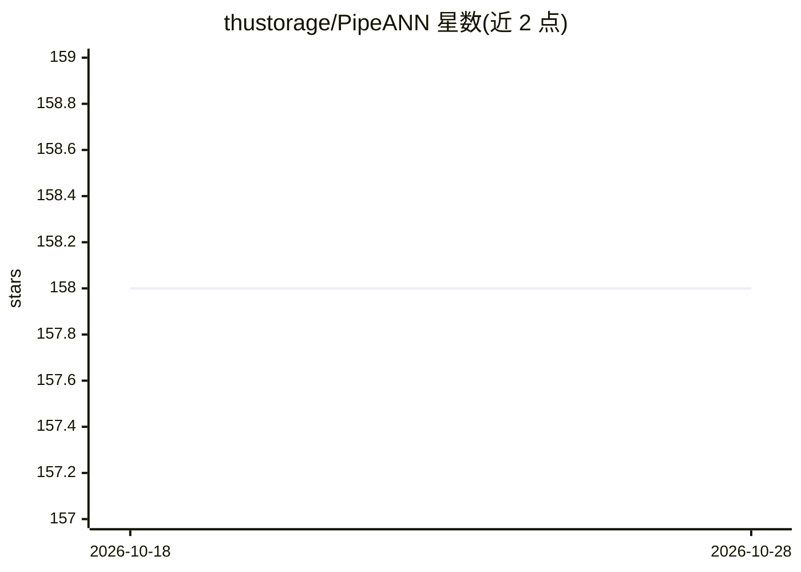

# thustorage/PipeANN

⭐ 158 · C++ · Apache-2.0 · 推送 2026-10-17 · [GitHub](https://github.com/thustorage/PipeANN) · [官网](https://thustorage.github.io/PipeANN/) · 组织维护 · 中文 README

**SSD 上的十亿级可更新图索引向量存储，兼容 Milvus API**

基于 SSD 的图索引向量存储系统，面向十亿级向量的近似最近邻搜索：通过流水线搜索与 PQ/RaBitQ 压缩实现低于内存方案延迟水平的同时显著降低内存占用（1B 向量约 40GB 内存），支持向量插入/删除更新、属性过滤搜索（Speculative Filtering）、多 SSD 扩展（SPDK 后端）。提供 Python（faiss 风格）与 C++ 双接口，并附带兼容 Milvus API 的进程内客户端与 gRPC 服务器。需在 Linux 上从源码编译（依赖 BLAS、libaio、io_uring 等），出自清华大学存储研究组，附多篇论文引用。

## 筛选速览

| 维度 | 判定 | 备注 |
|---|---|---|
| AI 角色 | `ai-ecosystem` | LLM/agent 周边工具 |
| 许可风险 | `permissive` | Apache-2.0 |
| 部署形态 | `library` | 以包/库形式分发 |
| 模型依赖 | — | README 未给出锁定关系 |
| 硬件要求 | — | 无带数字的原话,不猜 |
| 安装摩擦 | `medium` | 含编译或系统依赖之一 |
| 成熟度 | — | 结构信号不足 |

## 能力要点

- 1B 向量 top-10 90% 召回 <1ms 延迟、20K QPS，内存仅需约 40GB
- 插入/删除更新，搜索干扰小（1.07x 波动）
- 属性过滤 ANNS（Speculative Filtering）：100M 向量 3K QPS、6ms 延迟
- Milvus 兼容 API：进程内 MilvusClient 与 gRPC 服务器，可一行切换

## 适用场景

- 内存放不下十亿级向量的低成本向量检索
- 已有 Milvus 应用在不改代码的情况下换用磁盘索引
- 需要频繁插入删除的动态向量库

## 场景标签

`向量数据库` · 领域:知识与检索

## 证据(README 行号)

> L3: A low-latency, billion-scale, and updatable graph-based vector store on SSD.
> L15: |🔌 **Seamless Integration**|Milvus-compatible API (drop-in MilvusClient + gRPC server)|
> L36: from pipeann import MilvusClient

## 星数曲线

2026-10-18 158 → 2026-10-28 158（+0）

---
*卡片 v1 · prompt 1.4 · 生成 2026-10-22 · 置信度 high · 依据 README sha `6edd55a41968` · [字段定义](../../DATASET.md)*
