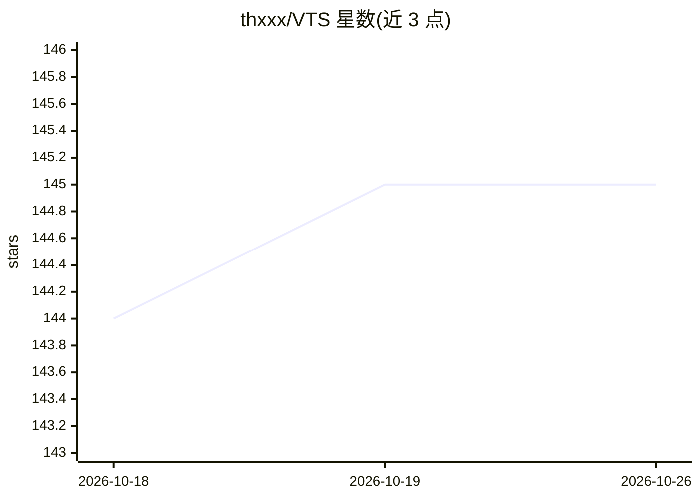

# thxxx/VTS

⭐ 145 · Python · MIT · 推送 2026-06-18 · [GitHub](https://github.com/thxxx/VTS) · [官网](https://spicy-pufferfish-699.notion.site/VTS-347cf95761f480f19dc0eb790e1467af?source=copy_link) · 个人维护

**用口述拟声草稿加文本提示生成音效的推理包**

面向音效设计师与音频开发者的推理专用包：输入一段短的人声拟声草稿（如 pshh-kting）与文本提示，经 VTS 模型生成 WAV 音效。机制上以冻结的 google/flan-t5-base 编码文本，从输入音频提取 12 通道动态特征（谱质心/RMS/chroma）作为声音条件，默认 64 步 ODE 采样与 CFG alpha 3.0；temperature 参数切换输入音频复用强度（generate/variation 两分支）。仅含推理代码，训练与数据集不包含；检查点托管在 Hugging Face，缺失时自动下载，需 HF_TOKEN 认证。

## 筛选速览

| 维度 | 判定 | 备注 |
|---|---|---|
| AI 角色 | `ai-native` | 本体是模型或模型工具 |
| 许可风险 | `permissive` | MIT |
| 部署形态 | `library` | 以包/库形式分发 |
| 模型依赖 | — | README 未给出锁定关系 |
| 硬件要求 | — | 无带数字的原话,不猜 |
| 安装摩擦 | `medium` | 含编译或系统依赖之一 |
| 成熟度 | — | 结构信号不足 |

## 能力要点

- 人声草稿 + 文本双条件的声音生成
- 12 通道动态特征（谱质心/RMS/chroma）作声音条件
- ODE 采样（默认 64 步）与 temperature 分支（generate/variation）
- 检查点缺失时自动从 Hugging Face 下载

## 适用场景

- 游戏/影视音效设计时用拟声草稿快速出样
- 文本描述不精确时用口述补充声音的节奏与轮廓
- 本地批量生成短 SFX 素材并输出 JSON 摘要

## 场景标签

 · 领域:音频生成/AI

## 证据(README 行号)

> L9: VTS turns that behavior into a new interface. **Instead of relying on text alone, you can give the model a short voc
> L17: VTS lets you do the obvious thing instead: sketch the sound with your voice, add a short text prompt, and generate 
> L21: Generate sound effects from:

## 星数曲线

2026-10-18 144 → 2026-10-26 145（+1）

---
*卡片 v1 · prompt 1.4 · 生成 2026-10-22 · 置信度 mid · 依据 README sha `1aa90bb83d30` · [字段定义](../../DATASET.md)*
