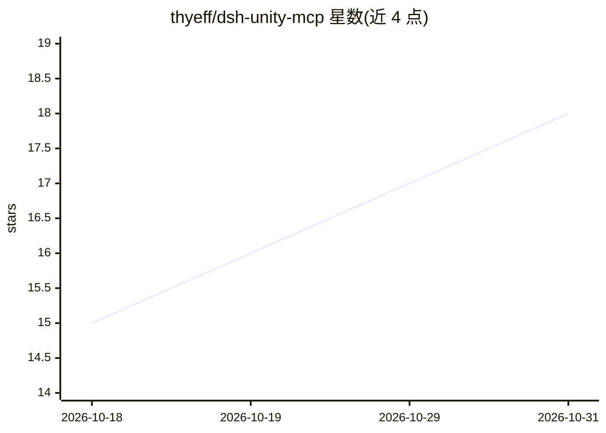

# thyeff/dsh-unity-mcp

⭐ 18 · JavaScript · MIT · 推送 2026-09-03 · [GitHub](https://github.com/thyeff/dsh-unity-mcp) · 个人维护 · 中文 README

**DSH 插件：让 AI Agent 通过 MCP 直接操控 Unity 编辑器**

面向 DeepSeek Harness（DSH）的插件，封装 CoderGamester/mcp-unity 1.4.0 服务端，安装后 DSH 内的 AI Agent 获得 34 个 Unity 编辑器工具（场景管理、GameObject 增删改查、Prefab、测试运行、控制台日志读取等），经 MCP stdio 与 Unity 编辑器进程内网桥（TCP :8090）通信。提供零配置安装、unity_status 网桥探测、自动重连与配置 schema 校验；需 DSH 核心 0.1.1-rc.2+ 与 Unity 2022.3+。

## 筛选速览

| 维度 | 判定 | 备注 |
|---|---|---|
| AI 角色 | `ai-ecosystem` | LLM/agent 周边工具 |
| 许可风险 | `permissive` | MIT |
| 部署形态 | `None` |  |
| 模型依赖 | locked-api |  |
| 硬件要求 | — | 无带数字的原话,不猜 |
| 安装摩擦 | `low` | 无编译、无系统依赖或容器化 |
| 成熟度 | — | 结构信号不足 |

## 能力要点

- 内置 mcp-unity 1.4.0 服务端，安装即用免手写配置
- 34 个 Unity 工具：场景/GameObject/组件/Prefab/测试/控制台
- unity_status 网桥探测：Unity 未启动时秒级反馈
- 自动重连与配置 schema 校验

## 适用场景

- 让 DSH 里的 Agent 直接查看和修改 Unity 场景与 GameObject
- 通过 Agent 运行 Unity 测试并读取控制台日志
- 搭配 dsh-mcp-lens 渐进披露以降低长对话 token 开销

## 场景标签

`GUI 自动化` · 领域:效率与自动化

## 证据(README 行号)

> L8: 让 DeepSeek Harness（DSH）里的 AI Agent **直接操控 Unity 编辑器**：一键安装本插件后，Agent 即可获得 34 个 Unity 工具，覆盖游戏开发全流程。
> L10: 本插件是 CoderGamester/mcp-unity（MIT）在 DeepSeek Harness 上的封装：内置 mcp-unity **1.4.0** 服务端，安装即用，无需手动编辑 `cordis.patch.yml`。
> L15: DSH Agent ──MCP(stdio)──> dsh-unity-mcp ──> 内置 mcp-unity 服务端 ──TCP :8090──> Unity 网桥包（编辑器进程内）

## 星数曲线

2026-10-18 15 → 2026-10-31 18（+3）

---
*卡片 v1 · prompt 1.4 · 生成 2026-10-29 · 置信度 high · 依据 README sha `e2a07ff65fce` · [字段定义](../../DATASET.md)*
