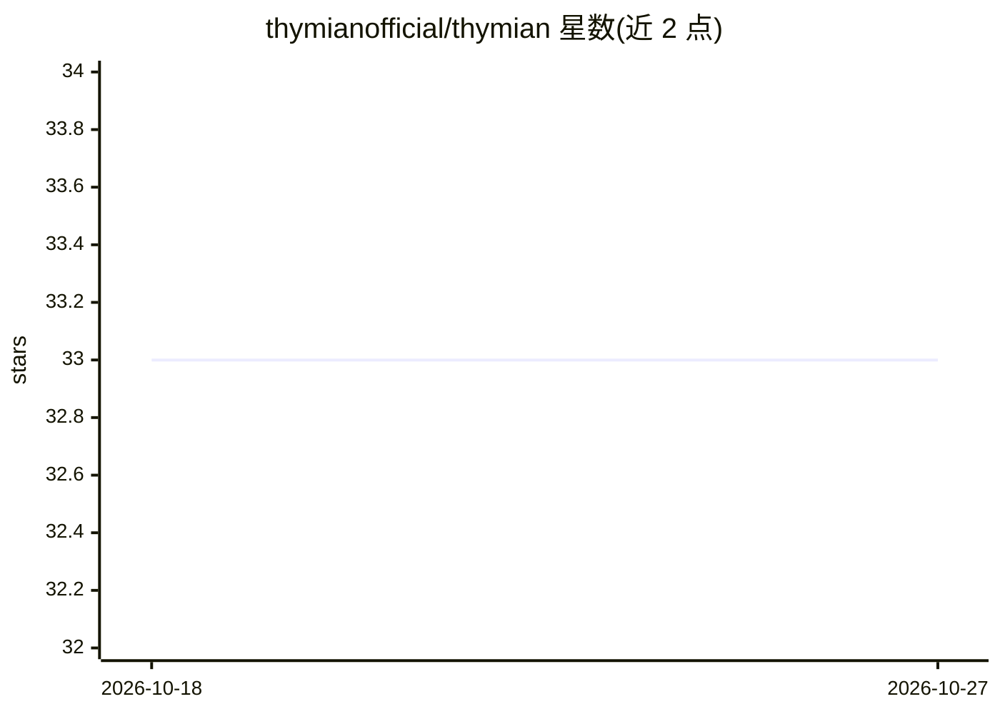

# thymianofficial/thymian

⭐ 33 · TypeScript · AGPL-3.0 · 推送 2026-10-26 · [GitHub](https://github.com/thymianofficial/thymian) · [官网](https://thymian.dev) · 组织维护

**语言无关的 HTTP 一致性与 API 治理校验工具**

面向 API 开发者的开源 HTTP 一致性与治理工具：对 API 按 RFC 9110 等标准与 OpenAPI 规范做校验，支持静态检查、对活跃端点测试以及对生产环境录制流量分析；同一规则定义可在 lint/test/analyze 三种命令下复用。提供插件机制与可通过 npm 分发的自定义规则，远程插件走 WebSocket。报告解释违规的 RFC 语义与现实影响。要求 Node.js 22 及以上，通过 npx 直接运行，无需本地安装。README 未描述任何 AI 功能，仓库标签含 ai/ai-agents 但正文无对应说明。

## 筛选速览

| 维度 | 判定 | 备注 |
|---|---|---|
| AI 角色 | `ai-ecosystem` | LLM/agent 周边工具 |
| 许可风险 | `viral` | AGPL-3.0 |
| 部署形态 | `library` | 以包/库形式分发 |
| 模型依赖 | — | README 未给出锁定关系 |
| 硬件要求 | — | 无带数字的原话,不猜 |
| 安装摩擦 | `low` | 无编译、无系统依赖或容器化 |
| 成熟度 | — | 结构信号不足 |

## 能力要点

- 按 RFC 9110 与 OpenAPI 规范校验 API
- 静态检查 / 活跃端点测试 / 生产流量分析三种模式
- 单一规则定义跨 lint/test/analyze 复用
- 插件与可 npm 分发的自定义规则、WebSocket 远程插件

## 适用场景

- 校验 API 是否符合 HTTP RFC 标准与 OpenAPI 规范
- 分析代理/CDN/负载均衡对生产环境 HTTP 语义的影响
- 在团队内共享统一的 API 治理规则

## 场景标签

 · 领域:API 治理/开发工具

## 证据(README 行号)

> L14: Thymian is a language-agnostic, open-source **HTTP conformance and API governance tool**. It validates your APIs ag
> L29: Thymian requires **Node.js 22 or newer**. We build and test on Node **22**, **24** and **26**.

## 星数曲线

2026-10-18 33 → 2026-10-27 33（+0）

---
*卡片 v1 · prompt 1.4 · 生成 2026-10-25 · 置信度 low · 依据 README sha `5b1b35f88ffd` · [字段定义](../../DATASET.md)*
