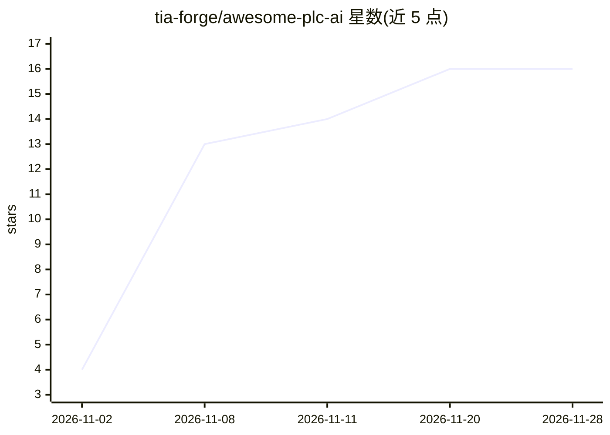

# tia-forge/awesome-plc-ai

⭐ 16 · Shell · CC0-1.0 · 推送 2026-11-19 · [GitHub](https://github.com/tia-forge/awesome-plc-ai) · 组织维护 · 中文 README

**给 PLC 工程师的 AI 工具/MCP 桥接精选清单**

由汇智网维护的 awesome 清单，收录面向 PLC 工程的 AI 工具：连接 AI agent 与工程工具或控制器的 MCP 网关、面向 Claude Code/Codex 等的技能包与规则包、工程 Copilot 与代码智能产品、静态校验与仿真工具，以及西门子、罗克韦尔等厂商自研工程智能体。条目按开源/商业/源码可得/on-prem 分类标注，附 SPDX 许可证与星数；开头设有安全声明，强调 AI 输出不得未经审查下装到真实控制器。

## 筛选速览

| 维度 | 判定 | 备注 |
|---|---|---|
| AI 角色 | `ai-knowledge` | 知识聚合/清单类 |
| 许可风险 | `viral` | CC0-1.0 |
| 部署形态 | `None` |  |
| 模型依赖 | — | README 未给出锁定关系 |
| 硬件要求 | — | 无带数字的原话,不猜 |
| 安装摩擦 | `low` | 无编译、无系统依赖或容器化 |
| 成熟度 | `idea` | |

## 能力要点

- 覆盖 TIA Portal、CODESYS、TwinCAT、Studio 5000、GX Works 六大工程环境的 MCP 桥接目录
- 条目统一标注开源/商业/源码可得/on-prem、SPDX 许可证与星数
- 包含安全声明：AI 输出仅为草稿生成器，须经审查、静态分析与仿真后才可使用
- 维护者自身产品 TiaLink 按同一标准收录并在文末披露

## 适用场景

- 为 TIA Portal 工程找可接入 Claude Code 的 MCP 服务器
- 给 PLC 代码审查挑选静态校验与 lint 工具
- 了解各自动化厂商自带的 AI 工程助手现状

## 场景标签

`精选清单` · 领域:学习与行业

## 证据(README 行号)

> L3: > A curated list of AI tools, agents and MCP bridges for **PLC engineering** — writing, reviewing, verifying and doc
> L5: **中文简介**：面向 PLC / 自动化工程师的「AI × 工业控制」清单：MCP 网关、Agent 技能包、工程 Copilot、静态校验与仿真工具，以及厂商侧的工程智能体。
> L20: **How entries are written.** *Open source* means the repository carries an open-source licence, named with its SPDX

## 星数曲线

2026-11-02 4 → 2026-11-28 16（+12）

---
*卡片 v1 · prompt 1.4 · 生成 2026-11-18 · 置信度 high · 依据 README sha `cdb10e8d7418` · [字段定义](../../DATASET.md)*
