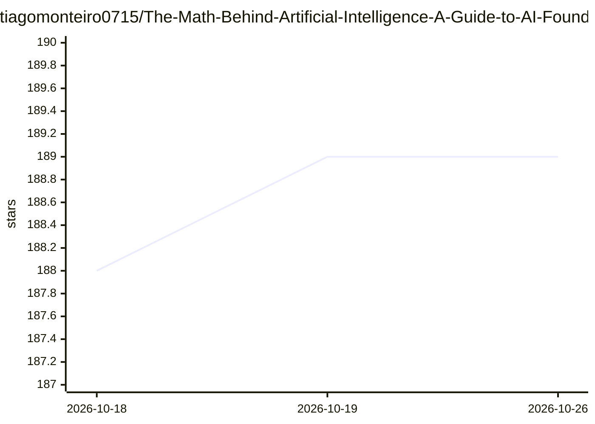

# tiagomonteiro0715/The-Math-Behind-Artificial-Intelligence-A-Guide-to-AI-Foundations

⭐ 189 · Python · MIT · 推送 2026-06-02 · [GitHub](https://github.com/tiagomonteiro0715/The-Math-Behind-Artificial-Intelligence-A-Guide-to-AI-Foundations) · [官网](https://www.freecodecamp.org/news/the-math-behind-artificial-intelligence-book) · 个人维护

**面向工程师的 AI 数学基础书籍（含 Python 示例）**

一本从工程视角讲解 AI 数学基础的书籍：覆盖数学体系架构、线性代数、多变量微积分、概率统计与优化理论（含梯度下降、Adam），并给出导数与反向传播关系等应用说明。每章附带 Python 与 LaTeX 代码文件夹，含动画可视化（积分、导数、线性回归）。面向学生、自学开发者与从业者，前提为基本编程知识与高中数学。通过 git clone 获取仓库。

## 筛选速览

| 维度 | 判定 | 备注 |
|---|---|---|
| AI 角色 | `ai-knowledge` | 知识聚合/清单类 |
| 许可风险 | `permissive` | MIT |
| 部署形态 | `None` |  |
| 模型依赖 | — | README 未给出锁定关系 |
| 硬件要求 | — | 无带数字的原话,不猜 |
| 安装摩擦 | `low` | 无编译、无系统依赖或容器化 |
| 成熟度 | — | 结构信号不足 |

## 能力要点

- 从工程视角连接数学理论与 AI 实践（可视化+Python 代码）
- 覆盖线性代数/微积分/概率统计/优化理论四大板块
- 每章附 Python 与 LaTeX 代码文件夹
- 含积分、导数、线性回归的动画可视化

## 适用场景

- 作为学生或自学开发者学习 AI 背后的数学基础
- 从业者在工程实践中回查反向传播等数学原理
- 配合每章代码示例动手理解概念

## 场景标签

`教程课程` · 领域:学习与行业

## 证据(README 行号)

> L5:  A comprehensive guide to AI's mathematical foundations from an engineering perspective
> L23: Written from an engineering perspective (think in terms of building blocks), it connects theory to practice with vi

## 星数曲线

2026-10-18 188 → 2026-10-26 189（+1）

---
*卡片 v1 · prompt 1.4 · 生成 2026-10-22 · 置信度 high · 依据 README sha `36bca6190e93` · [字段定义](../../DATASET.md)*
