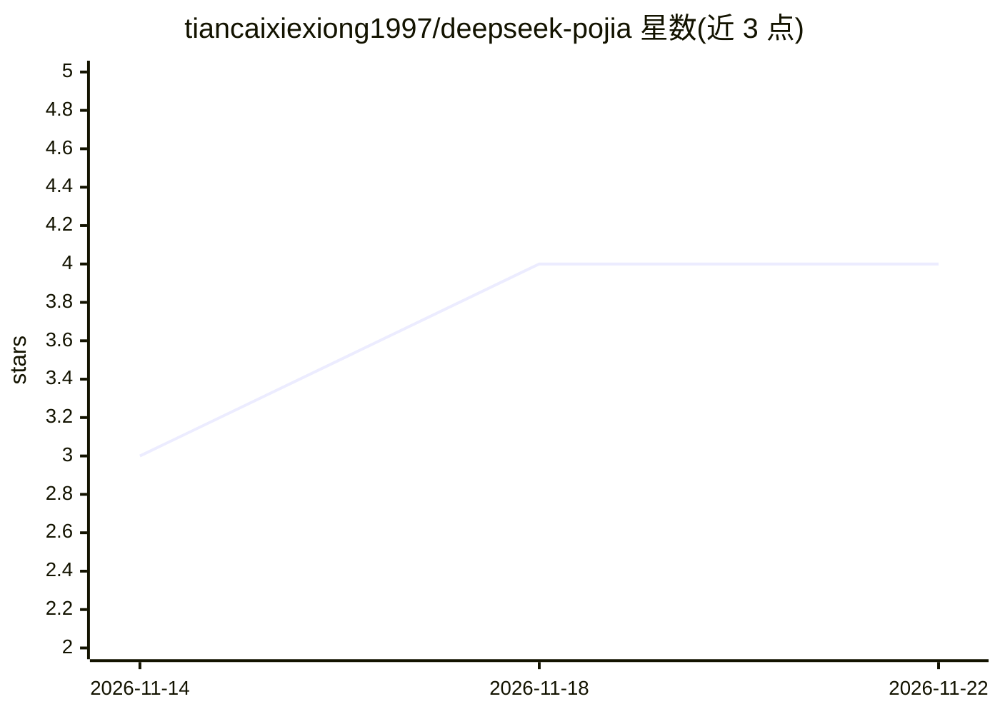

# tiancaixiexiong1997/deepseek-pojia

⭐ 4 · JavaScript · MIT · 推送 2026-11-12 · [GitHub](https://github.com/tiancaixiexiong1997/deepseek-pojia) · 个人维护 · 中文 README

**给 DeepSeek Harness 安装破甲/红队评测插件的一键安装器**

本仓库是 dsh-purge（DeepSeek Harness 的破甲/红队评测插件，v1.1.71，冻结自动更新）的再分发与安装器封装，上游为 YuJunZhiXue/dsh-purge（MIT）。提供 macOS/Linux/Windows 的一条命令安装脚本（curl/PowerShell/git clone），安装逻辑只写入 $DSH_HOME 的插件目录与 profile 配置；装完需在宿主内手动应用补丁（解包 app.asar 并重启），支持 --apply 走 headless 路径、--profile/--home 自定义安装位置，并提供 --status 验收与 --revert/--uninstall 回滚。README 附版本矩阵，标注部分补丁在宿主 0.2.2 上退化为 skipped。仅限自有设备上的模型行为评测用途。

## 筛选速览

| 维度 | 判定 | 备注 |
|---|---|---|
| AI 角色 | `ai-ecosystem` | LLM/agent 周边工具 |
| 许可风险 | `permissive` | MIT |
| 部署形态 | `desktop` | 安装包/桌面程序 |
| 模型依赖 | locked-api |  |
| 硬件要求 | — | 无带数字的原话,不猜 |
| 安装摩擦 | `low` | 无编译、无系统依赖或容器化 |
| 成熟度 | — | 结构信号不足 |

## 能力要点

- 一条命令安装器支持钉版本（tag）可复现安装与 main 跟随安装
- 安装脚本只修改 $DSH_HOME，旧目录与配置自动备份
- 提供 headless 应用路径（--apply）与状态验收（--status）
- 支持 --revert 还原宿主补丁与 --uninstall 完整卸载

## 适用场景

- 在自己的 DeepSeek Harness 实例上部署 dsh-purge 插件做红队演练
- 批量/智能体场景下用钉版本安装保证可复现
- 升级宿主后重新应用补丁并验收 pending=0

## 场景标签

`模型评测` · 领域:评测与运维

## 证据(README 行号)

> L3: DeepSeek Harness（dsh）的**破甲 / 红队评测插件**，本仓库 = 一个可直接 `git clone` 就能装上的 dsh-purge（1.1.71，已冻结自动更新），外加**一条命令的安装器**。
> L7: - 目标宿主：DeepSeek Harness **0.2.x**（桌面端 EXE 与官方 `dsh web` 都支持）
> L141: 仅用于自己的机器做模型行为评测与红队演练；不要拿它去碰不属于你的资产。

## 星数曲线

2026-11-14 3 → 2026-11-22 4（+1）

---
*卡片 v1 · prompt 1.4 · 生成 2026-11-21 · 置信度 mid · 依据 README sha `337ef7fb7dff` · [字段定义](../../DATASET.md)*
