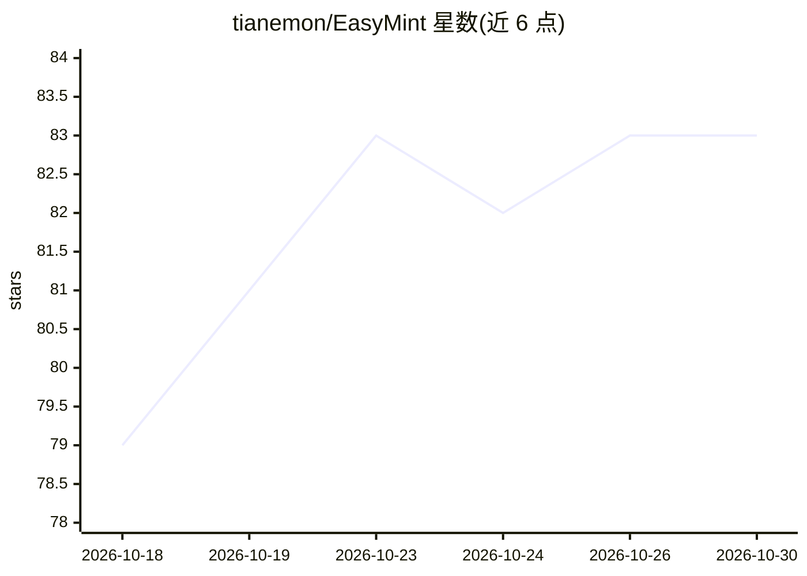

# tianemon/EasyMint

⭐ 83 · TypeScript · MIT · 推送 2026-10-29 · [GitHub](https://github.com/tianemon/EasyMint) · [官网](https://tianemon.github.io/EasyMint/) · 个人维护 · 中文 README

**桌面 AI 编程平台：内置 Pi Agent，让非技术用户对话式完成软件开发全流程**

基于 Electron 的开源桌面 AI 编程平台，内置 Pi Coding Agent 作为编码引擎。面向两类用户：初学者通过引导对话收集需求、确认原型与技术方案，以对话和选择驱动开发；开发者将其用作多智能体协作（Mint 项目管理、Builder 编码、Evaluator 验收、Mint-D 设计）的日常工作区。提供七道确认关口、交互式 HTML 原型、技能复用（Claude Code/Codex/GitHub Agent Skills）、MCP 插件支持。本地存储数据、跨设备加密迁移、无账号无遥测；三档权限模式配合 OS 沙箱（macOS Seatbelt/Linux bubblewrap/Windows 沙箱账户）。不支持云端多人协作，PRIVACY.md 与 CHANGELOG.md 为中文。

## 筛选速览

| 维度 | 判定 | 备注 |
|---|---|---|
| AI 角色 | `ai-native` | 本体是模型或模型工具 |
| 许可风险 | `permissive` | MIT |
| 部署形态 | `desktop` | 安装包/桌面程序 |
| 模型依赖 | — | README 未给出锁定关系 |
| 硬件要求 | — | 无带数字的原话,不猜 |
| 安装摩擦 | `low` | 无编译、无系统依赖或容器化 |
| 成熟度 | — | 结构信号不足 |

## 能力要点

- 七道关口覆盖意图、范围、原型、用户确认、技术方案、开发与验收
- 多智能体协作：项目管理、编码、评估、设计四个角色协调工作
- Read-only/Standard/Full 三档权限模式，含 OS 沙箱与网络域名白名单
- 复用 Claude Code、Codex、GitHub Agent Skills 生态技能及 MCP 插件

## 适用场景

- 不会编程的用户通过对话从想法生成可运行软件
- 开发者日常用多智能体协作管理 AI 编码会话
- 本地存储项目与数据并在多设备间加密迁移

## 场景标签

`编码 Agent` `多智能体` · 领域:Agent 开发

## 证据(README 行号)

> L7:  An open-source desktop AI coding platform with a built-in Pi Agent.
> L15: EasyMint is an **open-source desktop AI coding platform with a built-in Pi Agent**. Pi Coding Agent provides the co
> L19: - **Beginners**: guided conversations collect requirements and confirm prototypes and technical plans. Drive develo

## 星数曲线

2026-10-18 79 → 2026-10-30 83（+4）

---
*卡片 v1 · prompt 1.4 · 生成 2026-10-24 · 置信度 mid · 依据 README sha `1b5fdbf7d379` · [字段定义](../../DATASET.md)*
