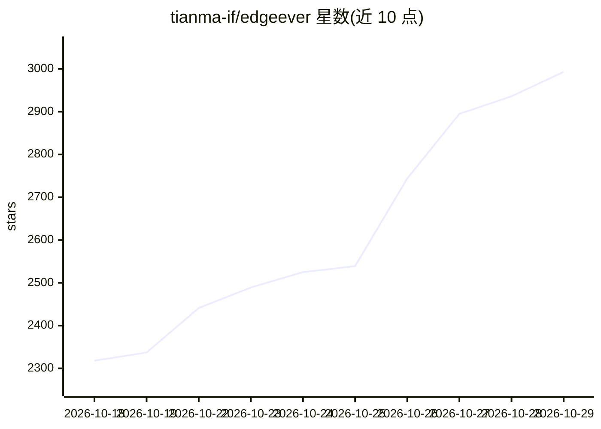

# tianma-if/edgeever

⭐ 2,993 · TypeScript · AGPL-3.0 · 推送 2026-10-28 · [GitHub](https://github.com/tianma-if/edgeever) · [官网](https://edgeever.org) · 个人维护 · 中文 README

**自托管/Serverless 知识库笔记，可接 AI Agent 与多端同步**

开源笔记与个人知识库工作台，保留三栏式（树目录·笔记列表·编辑器）布局，支持桌面/移动/网页多端即时同步与离线队列。部署方式：Cloudflare 免费额度（D1+R2，免服务器）或 Docker 自托管（VPS/NAS，amd64/arm64），数据为标准 SQLite，支持 ZIP 备份与 Markdown 导入导出。AI 部分为侧边栏助手（摘要/校对/翻译）、BYOK 兼容 OpenAI/Claude/Gemini、内置 MCP/ACP 协议、AI 多维表格与图表生成；另含浏览器剪藏扩展（20+ 平台深度结构化剪辑）与知识库一键发布。

## 筛选速览

| 维度 | 判定 | 备注 |
|---|---|---|
| AI 角色 | `ai-enhanced` | 去掉 AI 部分产品仍成立 |
| 许可风险 | `viral` | AGPL-3.0 |
| 部署形态 | `self-host` | docker 或自建部署 |
| 模型依赖 | — | README 未给出锁定关系 |
| 硬件要求 | — | 无带数字的原话,不猜 |
| 安装摩擦 | `low` | 无编译、无系统依赖或容器化 |
| 成熟度 | — | 结构信号不足 |

## 能力要点

- Cloudflare 免费额度运行或 Docker 一键自托管（GHCR 镜像 + install.sh）
- 内置 MCP 与 ACP 协议，供外部 Agent 读写及驱动本地编码 Agent
- BYOK 兼容 OpenAI/Claude/Gemini 与自定义端点
- 全平台客户端（macOS/Windows/Linux/iOS/Android）+ 浏览器剪藏扩展（20+ 平台）

## 适用场景

- 搭建免费的多端同步个人知识库，数据自己掌控
- 让外部 AI Agent 通过 MCP 直接读写我的笔记库
- 通过剪藏扩展从小红书、X、知乎等平台收集内容

## 场景标签

`知识库管理` · 领域:知识与检索

## 证据(README 行号)

> L21: EdgeEver is a modern, open-source notes and knowledge base workspace. It preserves the classic, high-efficiency thr
> L76: |**AI & Ecosystem**|• Companion sidebar AI assistant for summaries, proofreading & translations • BYOK (Bring Your 

## 星数曲线

2026-10-18 2,318 → 2026-10-29 2,993（+675）

---
*卡片 v1 · prompt 1.4 · 生成 2026-10-21 · 置信度 high · 依据 README sha `bef3a275c5a1` · [字段定义](../../DATASET.md)*
