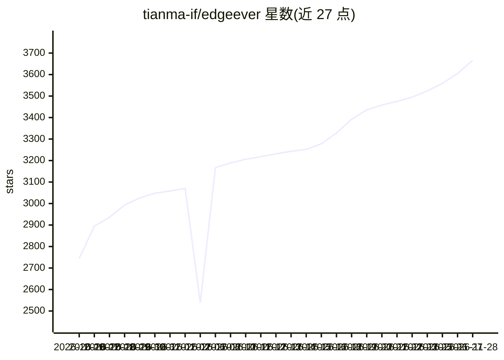

# tianma-if/edgeever

⭐ 3,666 · TypeScript · AGPL-3.0 · 推送 2026-11-27 · [GitHub](https://github.com/tianma-if/edgeever) · [官网](https://edgeever.org) · 个人维护 · 中文 README

**给个人知识管理者的开源 AI 笔记与知识库工作区**

开源三栏式（目录树·笔记列表·编辑器）笔记与知识库应用，提供多端客户端与网页工作区、即时多设备同步、富文本/Markdown 双模式编辑，支持表格、思维导图、Mermaid 图表、海报等富笔记类型，并内置网页剪藏（20+ 平台解析）与从 Evernote/Obsidian/Notion 等迁移的导入工具。AI 部分包括侧边栏助手（BYOK 兼容 OpenAI/Anthropic/Gemini 端点）、会话式生成图表与信息图、音视频转录，以及内置 MCP/ACP 协议驱动本地 agent。可零成本部署在 Cloudflare 免费额度内，或用 Docker 自托管。

## 筛选速览

| 维度 | 判定 | 备注 |
|---|---|---|
| AI 角色 | `ai-enhanced` | 去掉 AI 部分产品仍成立 |
| 许可风险 | `viral` | AGPL-3.0 |
| 部署形态 | `self-host` | docker 或自建部署 |
| 模型依赖 | — | README 未给出锁定关系 |
| 硬件要求 | — | 无带数字的原话,不猜 |
| 安装摩擦 | `low` | 无编译、无系统依赖或容器化 |
| 成熟度 | — | 结构信号不足 |

## 能力要点

- 三栏工作流 + 富文本/Markdown 双模式编辑，支持表格、思维导图、Mermaid 图表、海报笔记
- 浏览器剪藏扩展，针对 20+ 平台的专用解析器
- 内置 Remote MCP（按笔记本读写权限）与桌面 ACP，可驱动 Codex、Claude Code 等本地 agent
- BYOK 侧边栏 AI 助手与 OpenAI 兼容语音模型转录

## 适用场景

- 自托管一个免费的多端同步笔记与知识库
- 从 Evernote/Obsidian/Notion/Joplin 一键迁移笔记
- 用浏览器剪藏把网页文章转成干净 Markdown 收藏
- 通过对话生成思维导图、流程图和信息图卡片

## 场景标签

`知识库管理` `AI 助手` · 领域:对话与助手

## 证据(README 行号)

> L26: EdgeEver is a modern, open-source notes and knowledge base workspace. It preserves the classic, high-efficiency thr
> L82: |**AI & Agent Collaboration**|• **Companion AI Assistant & BYOK**: Sidebar AI for summaries, proofreading, translat
> L84: |**Multi-Device Sync & Self-Hosted Foundation**|• **Cross-Platform Instant Sync & Offline-First**: Official apps fo

## 星数曲线

2026-10-26 2,744 → 2026-11-28 3,666（+922）

---
*卡片 v1 · prompt 1.4 · 生成 2026-11-28 · 置信度 high · 依据 README sha `fcce1aedcc9a` · [字段定义](../../DATASET.md)*
