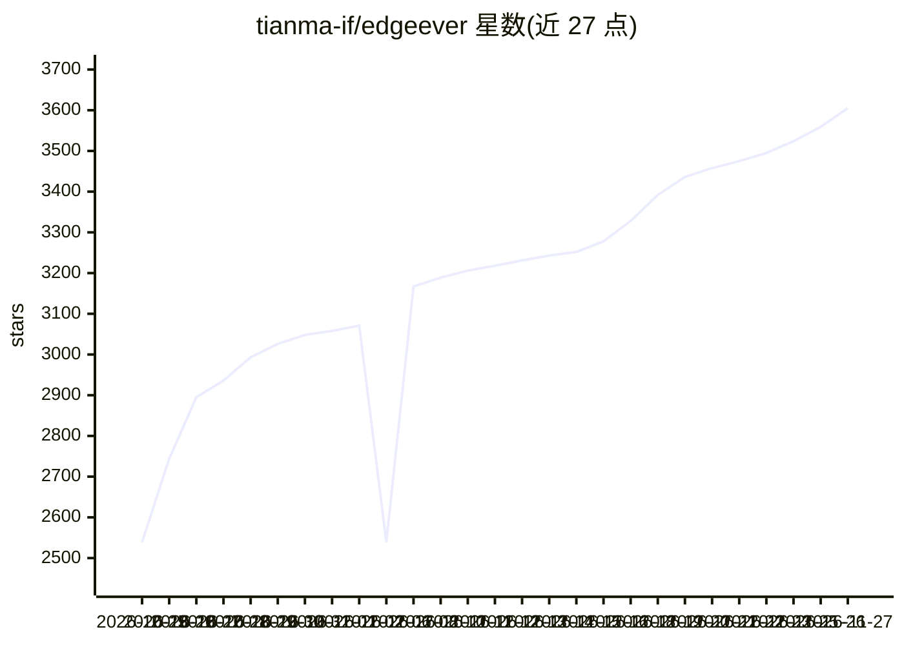

# tianma-if/edgeever

⭐ 3,605 · TypeScript · AGPL-3.0 · 推送 2026-11-26 · [GitHub](https://github.com/tianma-if/edgeever) · [官网](https://edgeever.org) · 个人维护 · 中文 README

**开源三栏布局笔记与知识库应用，支持自托管同步与 AI 集成**

开源笔记与知识库工作区，保留树视图、笔记列表、编辑器的三栏工作流，提供 Web/macOS/Windows/Linux/iOS/Android 客户端与浏览器 Web Clipper 扩展。支持富文本/Markdown 双模式编辑、思维导图、Mermaid 图表、20+ 平台的网页剪藏解析，以及从 Evernote、Obsidian、Notion 等一键迁移。部署上可在 Cloudflare 免费额度内以 serverless 方式运行，或用 Docker 自托管于 VPS/NAS；AI 功能采用 BYOK 模式接入用户自备的模型端点。

## 筛选速览

| 维度 | 判定 | 备注 |
|---|---|---|
| AI 角色 | `ai-enhanced` | 去掉 AI 部分产品仍成立 |
| 许可风险 | `viral` | AGPL-3.0 |
| 部署形态 | `self-host` | docker 或自建部署 |
| 模型依赖 | — | README 未给出锁定关系 |
| 硬件要求 | — | 无带数字的原话,不猜 |
| 安装摩擦 | `low` | 无编译、无系统依赖或容器化 |
| 成熟度 | — | 结构信号不足 |

## 能力要点

- 三栏工作流 + 富文本/Markdown 双模式编辑器，支持公式、大纲、修订历史
- 20+ 平台深度结构化剪藏解析，及 Evernote/Obsidian/Notion 等一键迁移
- 内置 MCP 远程服务（按笔记本读写权限）与桌面 ACP 驱动本地 agent
- Cloudflare 免费额度零成本 serverless 部署或 Docker 一键自托管

## 适用场景

- 自托管搭建跨平台即时同步的个人知识库
- 从 Evernote/Obsidian/Notion 迁移笔记并保留层级与附件
- 把网页文章剪藏为干净的 Markdown 存入自己的实例
- 通过 AI 对话生成表格、思维导图与信息图笔记

## 场景标签

`知识库管理` · 领域:知识与检索

## 证据(README 行号)

> L24: EdgeEver is a modern, open-source notes and knowledge base workspace. It preserves the classic, high-efficiency thr
> L80: |**AI & Agent Collaboration**|• **Companion AI Assistant & BYOK**: Sidebar AI for summaries, proofreading, translat
> L86: Cloudflare is the recommended zero-server deployment. Docker is available for users who prefer a VPS, NAS, or home 

## 星数曲线

2026-10-25 2,539 → 2026-11-27 3,605（+1,066）

---
*卡片 v1 · prompt 1.4 · 生成 2026-11-27 · 置信度 high · 依据 README sha `e4fd2ac15937` · [字段定义](../../DATASET.md)*
