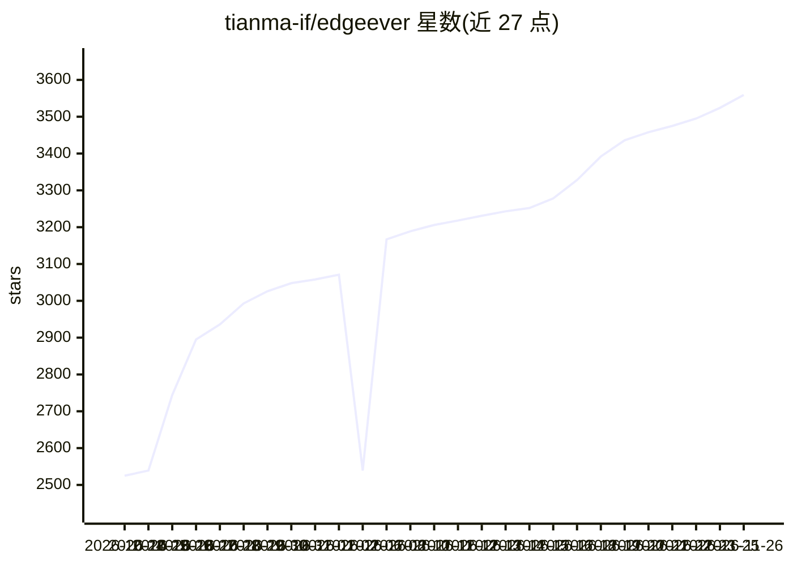

# tianma-if/edgeever

⭐ 3,559 · TypeScript · AGPL-3.0 · 推送 2026-11-25 · [GitHub](https://github.com/tianma-if/edgeever) · [官网](https://edgeever.org) · 个人维护 · 中文 README

**开源自托管笔记与知识库工作区，支持多端同步与 AI 助手**

三栏布局（目录树·笔记列表·编辑器）的开源笔记与知识库应用，支持富文本/Markdown 双模式编辑、思维导图、Mermaid 图表、AI 生成信息卡与多维表格，提供浏览器剪藏插件与 20+ 平台结构化解析，支持 Evernote/Obsidian/Notion 等迁移导入，可发布为静态知识库站点。部署路径为 Cloudflare 免费额度（Serverless）或 Docker 自托管；AI 部分采用 BYOK，兼容 OpenAI/Anthropic/Gemini 及自定义端点，内置远程 MCP 与桌面 ACP 协议。提供 Web/macOS/Windows/Linux/iOS/Android 客户端。

## 筛选速览

| 维度 | 判定 | 备注 |
|---|---|---|
| AI 角色 | `ai-enhanced` | 去掉 AI 部分产品仍成立 |
| 许可风险 | `viral` | AGPL-3.0 |
| 部署形态 | `self-host` | docker 或自建部署 |
| 模型依赖 | — | README 未给出锁定关系 |
| 硬件要求 | — | 无带数字的原话,不猜 |
| 安装摩擦 | `low` | 无编译、无系统依赖或容器化 |
| 成熟度 | — | 结构信号不足 |

## 能力要点

- Cloudflare 免费额度零服务器部署或 Docker 一键自托管
- 内置远程 MCP 与桌面 ACP，可驱动 Codex/Claude Code 等本地 agent
- AI BYOK 兼容 OpenAI、Anthropic、Gemini 及自定义端点
- 20+ 平台深度剪藏解析与 Evernote/Obsidian/Notion 一键迁移

## 适用场景

- 在 Cloudflare 免费额度上自托管多设备云同步笔记
- 用浏览器插件从知乎/小红书/X 等平台剪藏文章到自建实例
- 用 AI 助手对话生成思维导图、图表与信息卡
- 从 Evernote/Obsidian/Joplin 迁移笔记并保留层级与附件

## 场景标签

`知识库管理` · 领域:知识与检索

## 证据(README 行号)

> L24: EdgeEver is a modern, open-source notes and knowledge base workspace. It preserves the classic, high-efficiency thr
> L80: |**AI & Agent Collaboration**|• **Companion AI Assistant & BYOK**: Sidebar AI for summaries, proofreading, translat
> L82: |**Multi-Device Sync & Self-Hosted Foundation**|• **Cross-Platform Instant Sync & Offline-First**: Official apps fo

## 星数曲线

2026-10-24 2,525 → 2026-11-26 3,559（+1,034）

---
*卡片 v1 · prompt 1.4 · 生成 2026-11-24 · 置信度 high · 依据 README sha `32edbc4e6c71` · [字段定义](../../DATASET.md)*
