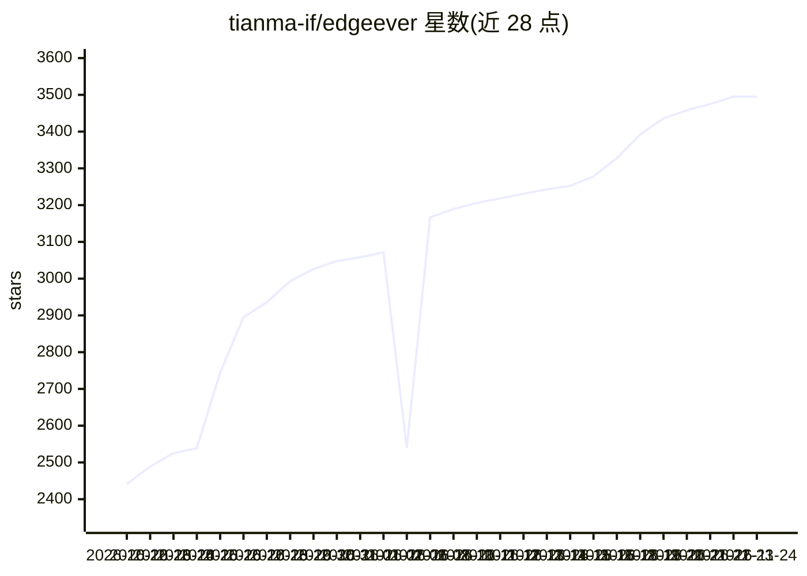

# tianma-if/edgeever

⭐ 3,495 · TypeScript · AGPL-3.0 · 推送 2026-11-22 · [GitHub](https://github.com/tianma-if/edgeever) · [官网](https://edgeever.org) · 个人维护 · 中文 README

**开源笔记与知识库应用：三栏工作流+AI Agent+多端同步**

开源笔记与知识库工作区，保留树视图·笔记列表·编辑器的三栏布局，支持富文本/Markdown 双模式编辑、无限层级目录、全文检索、多模态笔记（表格/思维导图/Mermaid 图/海报）与 20+ 平台网页剪藏。AI 侧提供侧边栏助手（BYOK 接入 OpenAI/Anthropic/Gemini 等）、内置 MCP 与 ACP 协议、音视频转写。可免费部署于 Cloudflare 免费额度，或用 Docker 自托管于 VPS/NAS；提供 macOS/Windows/Linux/iOS/Android 客户端与浏览器剪藏扩展。

## 筛选速览

| 维度 | 判定 | 备注 |
|---|---|---|
| AI 角色 | `ai-enhanced` | 去掉 AI 部分产品仍成立 |
| 许可风险 | `viral` | AGPL-3.0 |
| 部署形态 | `self-host` | docker 或自建部署 |
| 模型依赖 | — | README 未给出锁定关系 |
| 硬件要求 | — | 无带数字的原话,不猜 |
| 安装摩擦 | `low` | 无编译、无系统依赖或容器化 |
| 成熟度 | — | 结构信号不足 |

## 能力要点

- Cloudflare 免费额度零服务器部署，或 Docker 自托管
- 三栏工作流+富文本/Markdown 双模式编辑+毫秒级全文检索
- 原生 MCP 与 ACP 协议，可驱动本地 Agent（Codex/Claude Code 等）
- Evernote/Obsidian/Notion/SiYuan/flomo/Joplin 一键迁移导入

## 适用场景

- 多设备即时同步的个人知识库
- 网页内容剪藏与微信聊天记录归档到笔记
- 通过对话生成思维导图/架构图/信息图
- 把笔记本一键发布为静态知识库网站

## 场景标签

`知识库管理` · 领域:知识与检索

## 证据(README 行号)

> L24: EdgeEver is a modern, open-source notes and knowledge base workspace. It preserves the classic, high-efficiency thr
> L80: |**AI & Agent Collaboration**|• **Companion AI Assistant & BYOK**: Sidebar AI for summaries, proofreading, translat
> L82: |**Multi-Device Sync & Self-Hosted Foundation**|• **Cross-Platform Instant Sync & Offline-First**: Official apps fo

## 星数曲线

2026-10-22 2,441 → 2026-11-24 3,495（+1,054）

---
*卡片 v1 · prompt 1.4 · 生成 2026-11-23 · 置信度 high · 依据 README sha `d7f3cf330899` · [字段定义](../../DATASET.md)*
