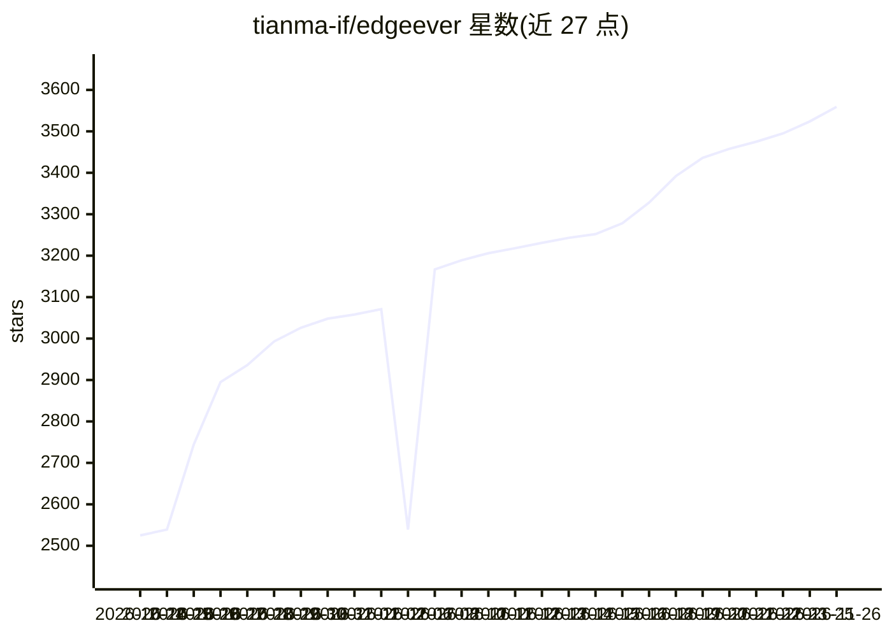

# tianma-if/edgeever

⭐ 3,559 · TypeScript · AGPL-3.0 · 推送 2026-11-25 · [GitHub](https://github.com/tianma-if/edgeever) · [官网](https://edgeever.org) · 个人维护 · 中文 README

**面向个人知识管理用户的开源云同步笔记与知识库**

开源三栏式笔记与知识库应用（目录树·列表·编辑器），支持富文本/Markdown 双模式编辑、思维导图、Mermaid 图表、信息图与海报类笔记；提供全平台客户端与浏览器 Web Clipper，支持对 20+ 平台网页的结构化剪藏，及从 Evernote、Obsidian、Notion 等一键导入。部署方式为 Cloudflare 免费额度或 Docker 自托管，后端依赖 SQLite/D1/R2 存储。AI 部分含侧栏助手（BYOK 多端点）、对话式生成表格/思维导图/转录，以及内置 MCP/ACP 协议接入本地 agent。

## 筛选速览

| 维度 | 判定 | 备注 |
|---|---|---|
| AI 角色 | `ai-enhanced` | 去掉 AI 部分产品仍成立 |
| 许可风险 | `viral` | AGPL-3.0 |
| 部署形态 | `self-host` | docker 或自建部署 |
| 模型依赖 | — | README 未给出锁定关系 |
| 硬件要求 | — | 无带数字的原话,不猜 |
| 安装摩擦 | `low` | 无编译、无系统依赖或容器化 |
| 成熟度 | — | 结构信号不足 |

## 能力要点

- 三栏工作流 + 富文本/Markdown 双模编辑 + 全文搜索
- 20+ 平台结构化网页剪藏与多格式导出（图片/MD/HTML/PDF）
- BYOK AI 助手与对话式生成表格、思维导图、信息图、转录
- Cloudflare 免费额度部署或 Docker 自托管，支持 MCP/ACP agent 协议

## 适用场景

- 替代 Evernote/Obsidian 做全平台云同步笔记
- 剪藏网页文章与社交平台内容沉淀进知识库
- 通过对话生成表格、思维导图等信息组织形式
- 自托管部署并接入本地 AI agent 管理笔记

## 场景标签

`知识库管理` · 领域:知识与检索

## 证据(README 行号)

> L24: EdgeEver is a modern, open-source notes and knowledge base workspace. It preserves the classic, high-efficiency thr
> L80: |**AI & Agent Collaboration**|• **Companion AI Assistant & BYOK**: Sidebar AI for summaries, proofreading, translat
> L82: |**Multi-Device Sync & Self-Hosted Foundation**|• **Cross-Platform Instant Sync & Offline-First**: Official apps fo

## 星数曲线

2026-10-24 2,525 → 2026-11-26 3,559（+1,034）

---
*卡片 v1 · prompt 1.4 · 生成 2026-11-26 · 置信度 high · 依据 README sha `4d11ec50e24f` · [字段定义](../../DATASET.md)*
