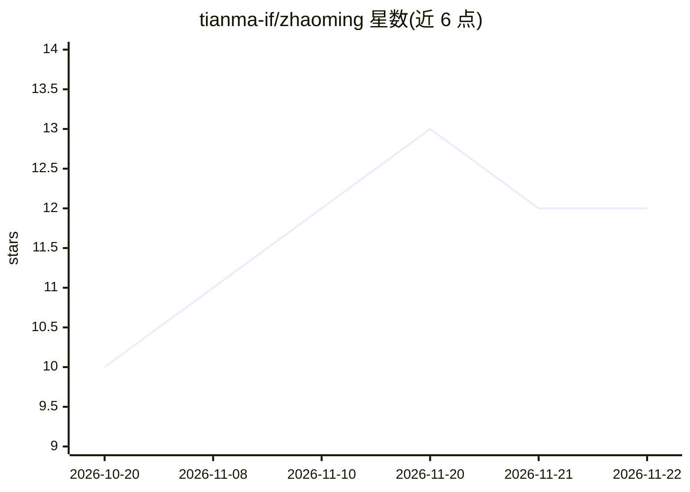

# tianma-if/zhaoming

⭐ 12 · TypeScript · NOASSERTION · 推送 2026-07-11 · [GitHub](https://github.com/tianma-if/zhaoming) · [官网](https://zhaoming.app) · 个人维护 · 中文 README

**面向命理爱好者的 AI 排盘与流式解盘工作台**

基于 Next.js + React 的命理排盘与分析 Web 应用，覆盖八字、紫微斗数、奇门遁甲/太乙/六壬三式、六爻、梅花易数、称骨等门类，各门类均接入大模型流式解盘。技术栈包含 Better Auth 鉴权、Neon Postgres 数据库与 Vercel AI SDK，模型通过 OpenAI-compatible Provider 接入。本地使用 Bun 管理依赖，需配置数据库、鉴权与大模型环境变量，支持 Vercel 部署。

## 筛选速览

| 维度 | 判定 | 备注 |
|---|---|---|
| AI 角色 | `ai-native` | 本体是模型或模型工具 |
| 许可风险 | `none` | NOASSERTION |
| 部署形态 | `None` |  |
| 模型依赖 | locked-api |  |
| 硬件要求 | — | 无带数字的原话,不猜 |
| 安装摩擦 | `low` | 无编译、无系统依赖或容器化 |
| 成熟度 | — | 结构信号不足 |

## 能力要点

- 七种命理门类的排盘与测算
- 各门类接入 AI 流式解盘（Streaming）
- 紫微斗数支持 4x4 中空环形星盘绘制
- 通过 OpenAI-compatible Provider 默认接入 OpenRouter

## 适用场景

- 排八字、紫微等命盘并获得 AI 解盘
- 在本地部署一个无广告的命理工作台
- 查询称骨斤两或起卦装卦

## 场景标签

 · 领域:传统文化/AI 应用

## 证据(README 行号)

> L14: 项目核心提供以下数术门类的排盘与测算，且均已接入 AI 智能流式解盘（Streaming）：
> L40: - `OpenAI-compatible Provider`（当前默认用于接 `OpenRouter`）

## 星数曲线

2026-10-20 10 → 2026-11-22 12（+2）

---
*卡片 v1 · prompt 1.4 · 生成 2026-11-18 · 置信度 high · 依据 README sha `b181deaba7d4` · [字段定义](../../DATASET.md)*
