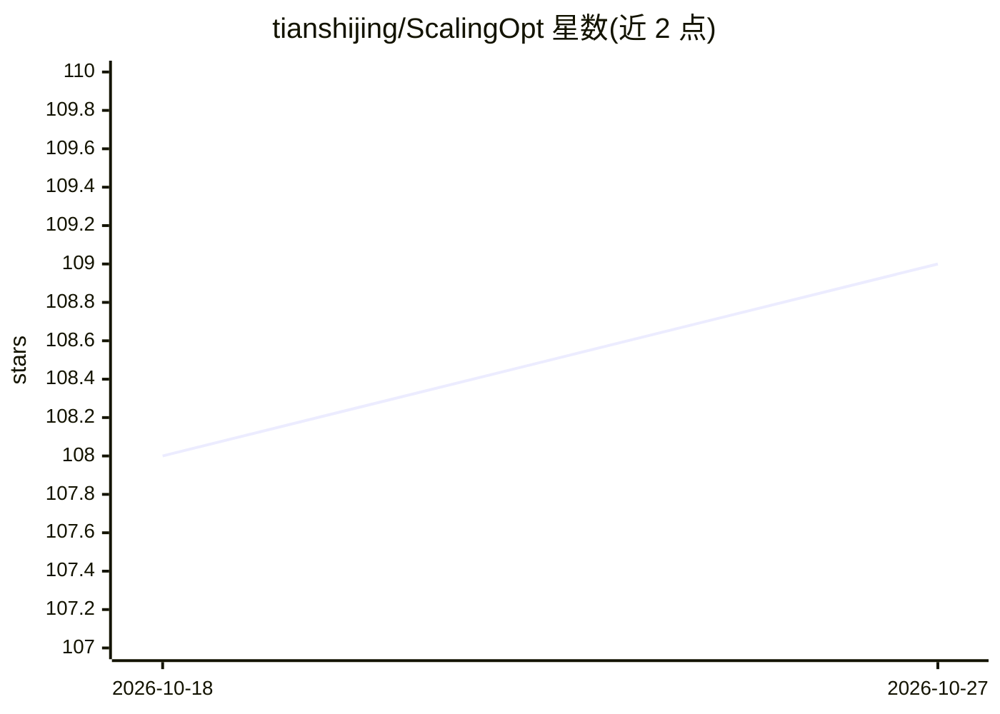

# tianshijing/ScalingOpt

⭐ 109 · HTML · 推送 2026-09-19 · [GitHub](https://github.com/tianshijing/ScalingOpt) · [官网](https://tianshijing.github.io/ScalingOpt/) · 组织维护

**面向高效 AI 的优化方法知识社区与策展中心**

围绕高效 AI 的优化主题社区与知识枢纽：收录带元数据的优化器目录、优化方向的科研博客与教程、基准总结与训练实践指导。社区维护者发布自有优化器 Mano/Mano v2，并整理深度学习优化总结表（收录 100 余种优化器）及优化器综述。内容由社区驱动持续更新，以 GitHub 仓库与配套网站形式提供，面向优化方向的研究者与实践者。

## 筛选速览

| 维度 | 判定 | 备注 |
|---|---|---|
| AI 角色 | `ai-knowledge` | 知识聚合/清单类 |
| 许可风险 | `none` | — |
| 部署形态 | `None` |  |
| 模型依赖 | — | README 未给出锁定关系 |
| 硬件要求 | — | 无带数字的原话,不猜 |
| 安装摩擦 | `low` | 无编译、无系统依赖或容器化 |
| 成熟度 | `idea` | |

## 能力要点

- 带详细元数据的优化器目录
- 收录 100 余种优化器的深度学习优化总结表
- 发布自有优化器 Mano / Mano v2 与优化器综述
- 科研博客、教程与基准总结

## 适用场景

- 查找与比较深度学习优化器及其元数据
- 学习现代优化方法与训练实践
- 跟进高效 AI 优化的研究与社区动态

## 场景标签

`科研工具` `教程课程` `精选清单` · 领域:学习与行业

## 证据(README 行号)

> L10: ScalingOpt is an optimization-centric community and knowledge hub for efficient AI. We focus on optimization method
> L17: - A comprehensive optimizer directory with detailed metadata

## 星数曲线

2026-10-18 108 → 2026-10-27 109（+1）

---
*卡片 v1 · prompt 1.4 · 生成 2026-10-23 · 置信度 high · 依据 README sha `d120e35d2a5f` · [字段定义](../../DATASET.md)*
