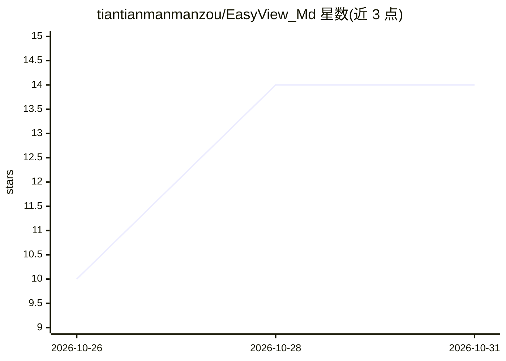

# tiantianmanmanzou/EasyView_Md

⭐ 14 · TypeScript · MIT · 推送 2026-10-26 · [GitHub](https://github.com/tiantianmanmanzou/EasyView_Md) · [官网](https://easyview.wonderxy.art) · 个人维护 · 中文 README

**面向 VS Code/Cursor 与桌面的可视化 Markdown 编辑器**

以 VS Code/Cursor 扩展和 Electron 桌面应用（macOS/Windows）两种形态提供的可视化 Markdown 编辑器，共享同一编辑核心、序列化器、表格实现与导出管线。功能覆盖 WYSIWYG 编辑与源码模式、可编辑表格、KaTeX 数学、Mermaid 图表、PDF/Word 转 Markdown（需 Pandoc/LibreOffice/Poppler），以及 HTML/PDF/DOCX/XLSX 导出。桌面版另含 Git 文件操作与内嵌终端。本仓库描述提到 AI refinement，但可见 README 未展开 AI 功能细节。

## 筛选速览

| 维度 | 判定 | 备注 |
|---|---|---|
| AI 角色 | `ai-enhanced` | 去掉 AI 部分产品仍成立 |
| 许可风险 | `permissive` | MIT |
| 部署形态 | `library` | 以包/库形式分发 |
| 模型依赖 | — | README 未给出锁定关系 |
| 硬件要求 | — | 无带数字的原话,不猜 |
| 安装摩擦 | `low` | 无编译、无系统依赖或容器化 |
| 成熟度 | — | 结构信号不足 |

## 能力要点

- VS Code 扩展与 Electron 桌面应用共享同一编辑核心与导出管线
- 右键将 PDF/Word 文档转为 Markdown，图片抽取为相对引用资源
- 支持可编辑表格、KaTeX 数学、Mermaid 图表、70+ 语言代码高亮
- 导出 HTML/PDF/DOCX/XLSX，PDF 导出内置中文字体

## 适用场景

- 在 VS Code 或 Cursor 中以所见即所得方式编辑 Markdown 文档
- 把 PDF 或 Word 文档转换成可编辑的 Markdown
- 脱离 VS Code 在桌面端编辑 Markdown 并导出多种格式

## 场景标签

`文档解析` · 领域:知识与检索

## 证据(README 行号)

> L26: EasyView_Md is a visual Markdown editor available as a VS Code/Cursor extension and an Electron desktop application
> L48: The desktop application runs independently of VS Code on macOS and Windows. It supports Markdown editing, built-in 

## 星数曲线

2026-10-26 10 → 2026-10-31 14（+4）

---
*卡片 v1 · prompt 1.4 · 生成 2026-10-31 · 置信度 mid · 依据 README sha `3977e96da337` · [字段定义](../../DATASET.md)*
