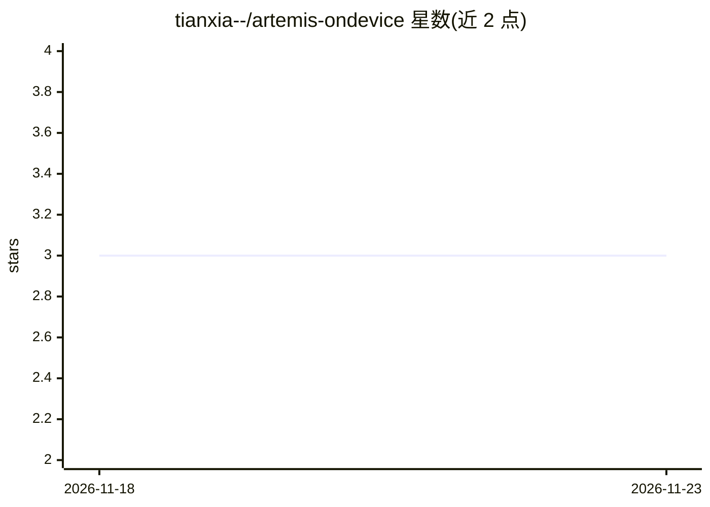

# tianxia--/artemis-ondevice

⭐ 3 · Java · Apache-2.0 · 推送 2026-11-18 · [GitHub](https://github.com/tianxia--/artemis-ondevice) · 个人维护 · 中文 README

**在 Android 手机上运行的 GUI agent：读屏并点击滑动完成任务**

以无障碍服务读取屏幕截图与带索引的 UI 元素列表，经一次模型调用产出 tap/swipe/type 等工具调用，在手机上执行直至任务完成；仅模型调用走用户配置的 OpenAI 兼容或 Anthropic 端点。功能含悬浮泡、逐步运行详情与 token 统计、录制回放的 Skills、敏感操作前确认、经验沉淀、MCP server（默认关闭）与离线普通话语音唤醒。金融支付类应用操作被硬性禁止。发布形态为 APK，源码构建需 JDK 17 与 Android SDK。

## 筛选速览

| 维度 | 判定 | 备注 |
|---|---|---|
| AI 角色 | `ai-native` | 本体是模型或模型工具 |
| 许可风险 | `permissive` | Apache-2.0 |
| 部署形态 | `None` |  |
| 模型依赖 | — | README 未给出锁定关系 |
| 硬件要求 | — | 无带数字的原话,不猜 |
| 安装摩擦 | `medium` | 含编译或系统依赖之一 |
| 成熟度 | `idea` | |

## 能力要点

- 截图+元素索引发给模型，工具调用直接在手机执行（tap/long_press/type_text/swipe 等）
- Skills 录制回放：重复任务不调用模型，仅末次调用校验屏幕
- 敏感操作（支付/删除/发帖等）执行前底部确认，银行支付类应用硬性禁操作
- 可选 MCP server：电脑端 Claude Code/Cursor 可向手机下发任务

## 适用场景

- 用自然语言让手机自动完成设置查询、应用操作等任务
- 录制常用流程为 skill 后离线回放省 token
- 研究移动端 GUI agent 的 observe-act 机制

## 场景标签

`GUI 自动化` · 领域:效率与自动化

## 证据(README 行号)

> L5: A phone agent that runs entirely on an Android phone (Android 11+). You describe a task in plain
> L32: Each step: screenshot + indexed UI element list (accessibility service) -> one model call with
> L184: - **The agent can make mistakes.** A language model decides every tap, swipe and text entry,

## 星数曲线

2026-11-18 3 → 2026-11-23 3（+0）

---
*卡片 v1 · prompt 1.4 · 生成 2026-11-21 · 置信度 high · 依据 README sha `d11f2ccafc66` · [字段定义](../../DATASET.md)*
