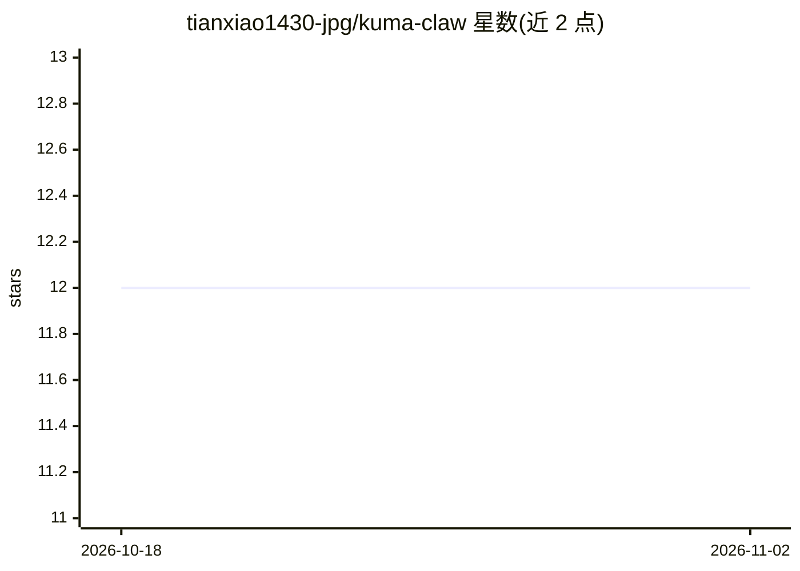

# tianxiao1430-jpg/kuma-claw

⭐ 12 · Python · Apache-2.0 · 推送 2026-04-01 · [GitHub](https://github.com/tianxiao1430-jpg/kuma-claw) · 个人维护 · 中文 README

**基于 Google ADK 的 AI 办公助手，一键部署到 GCP**

用 Python 构建的 AI 办公助手，基于 Google ADK 与 Gemini，提供 Telegram、Slack 及 Web 多渠道接入，模块化技能系统、长期记忆与上下文管理，集成 Gmail、Calendar、Sheets、Docs 与 DuckDuckGo 搜索。面向小企业与独立开发者，支持一键部署到 GCP Cloud Run 免费层，也可本地以 CLI 或服务模式运行。版本 v0.1.1，README 标注状态为 In Development，前端管理面板与 Discord/WhatsApp 渠道为规划中功能。

## 筛选速览

| 维度 | 判定 | 备注 |
|---|---|---|
| AI 角色 | `ai-native` | 本体是模型或模型工具 |
| 许可风险 | `permissive` | Apache-2.0 |
| 部署形态 | `library` | 以包/库形式分发 |
| 模型依赖 | — | README 未给出锁定关系 |
| 硬件要求 | — | 无带数字的原话,不猜 |
| 安装摩擦 | `low` | 无编译、无系统依赖或容器化 |
| 成熟度 | `idea` | |

## 能力要点

- Telegram/Slack/Web 多渠道接入
- 模块化技能系统与长期记忆
- Google Workspace（Gmail/Calendar/Sheets/Docs）集成
- GCP Cloud Run 一键部署

## 适用场景

- 小团队部署一个接入 Telegram/Slack 的 AI 办公助手
- 通过助手处理邮件、日历、表格等 Google Workspace 任务
- 在 GCP 免费层低成本运行 AI 助手服务

## 场景标签

`AI 助手` · 领域:对话与助手

## 证据(README 行号)

> L7: > 🦞 AI Office Assistant built on Google ADK
> L24: |**AI**|Google Generative AI (Gemini)|
> L96: - **Multi-Channel**: Telegram, Slack, Web (Discord, WhatsApp planned)

## 星数曲线

2026-10-18 12 → 2026-11-02 12（+0）

---
*卡片 v1 · prompt 1.4 · 生成 2026-10-31 · 置信度 mid · 依据 README sha `03e98255c97a` · [字段定义](../../DATASET.md)*
