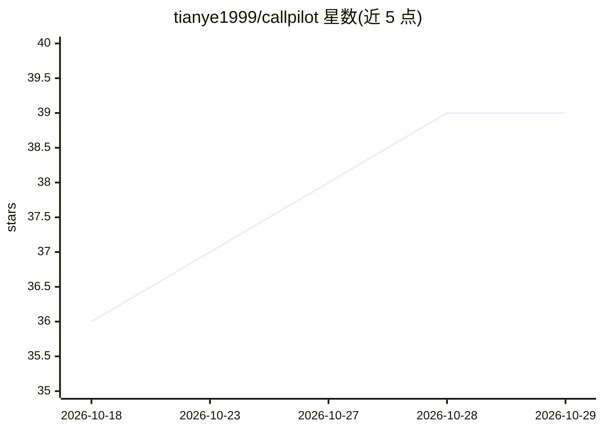

# tianye1999/callpilot

⭐ 39 · Python · Apache-2.0 · 推送 2026-10-26 · [GitHub](https://github.com/tianye1999/callpilot) · [官网](https://tianye1999.github.io/callpilot/) · 个人维护 · 中文 README

**自托管 AI 电话代理：4G 模块上用实时语音 AI 接打电话**

运行在 Quectel EC20/EG25 4G 模块上的蜂窝电话 AI 代理：通过硬件 AT 事件（RING→ATA）实现真实蜂窝通话的自动接听与外呼，实时语音模型默认走阿里 Qwen Omni，可选豆包、OpenAI Realtime，或完全本地的 VAD→STT→LLM→TTS 三段式管道。支持收发短信、DTMF 按键导航 IVR、AI 工具调用、通话录音与 LLM 摘要。提供签名 macOS DMG 桌面应用与源码运行两种途径，需自备 ~$20 的 EC20 模块 + 适配板 + 支持语音的 SIM 卡，并需 DashScope API key；Windows 路径已实现但等待硬件验证。

## 筛选速览

| 维度 | 判定 | 备注 |
|---|---|---|
| AI 角色 | `ai-native` | 本体是模型或模型工具 |
| 许可风险 | `permissive` | Apache-2.0 |
| 部署形态 | `desktop` | 安装包/桌面程序 |
| 模型依赖 | — | README 未给出锁定关系 |
| 硬件要求 | — | 无带数字的原话,不猜 |
| 安装摩擦 | `medium` | 含编译或系统依赖之一 |
| 成熟度 | `idea` | |

## 能力要点

- 基于 Quectel EC20/EG25 AT 事件的真实蜂窝通话（非 VoIP/屏幕自动化）
- 实时语音可选 Qwen Omni / OpenAI Realtime / 豆包，或本地三段式管道
- AI 工具调用：发短信、挂断、读验证码、DTMF 按键
- 每通电话录音 + 延迟指标 + LLM 摘要，双语文本 UI

## 适用场景

- 让 AI 自动接听来电并完成通话后给出摘要
- 批量外呼执行预设任务（含白名单与任务预设库）
- 让 AI 代替我按键导航 IVR 菜单、读取短信验证码
- 通话与短信内容全部留在自己设备上，不经过云端存储

## 场景标签

`语音 Agent` · 领域:对话与助手

## 证据(README 行号)

> L42: CallPilot bridges a cellular modem to a cloud realtime voice model, so an AI
> L53: - **AI brain:** cloud realtime speech-to-speech (Alibaba **Qwen Omni** by default,
> L59:  **DTMF keypad**), per-call recording + latency metrics + LLM summary, live

## 星数曲线

2026-10-18 36 → 2026-10-29 39（+3）

---
*卡片 v1 · prompt 1.4 · 生成 2026-10-25 · 置信度 mid · 依据 README sha `938f356ae316` · [字段定义](../../DATASET.md)*
