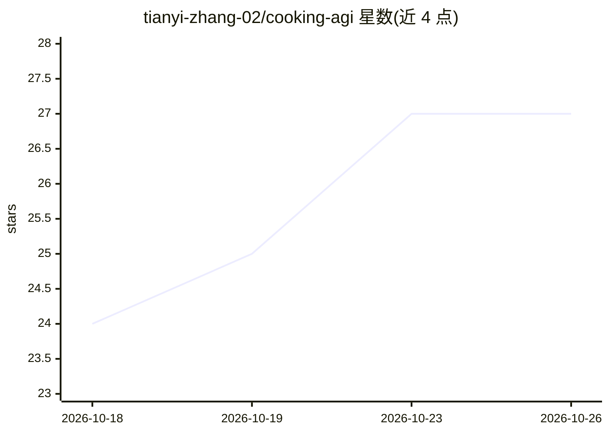

# tianyi-zhang-02/cooking-agi

⭐ 27 · Python · NOASSERTION · 推送 2026-10-24 · [GitHub](https://github.com/tianyi-zhang-02/cooking-agi) · 个人维护 · 中文 README

**中英双语 ML/LLM 学习与面试准备笔记站**

个人维护的中英双语 ML/LLM 学习笔记静态站点：内容覆盖模型原理（Transformer/BERT/CLIP）、训练与后训练（PPO/RLHF）、推理、RAG、深度强化学习、技术史与求职笔记，配分步图解、代码练习与项目走查。按新手入门、学习计划、面试速览等路线组织，阅读进度保存在浏览器本地。提供面向 Claude Code/Codex 等 agent 的面试陪练技能（npx 安装），可用 Python 3.12 从源码本地构建运行。内容采用 CC BY 4.0（笔记）与 MIT（代码）许可。

## 筛选速览

| 维度 | 判定 | 备注 |
|---|---|---|
| AI 角色 | `ai-knowledge` | 知识聚合/清单类 |
| 许可风险 | `none` | NOASSERTION |
| 部署形态 | `library` | 以包/库形式分发 |
| 模型依赖 | — | README 未给出锁定关系 |
| 硬件要求 | — | 无带数字的原话,不猜 |
| 安装摩擦 | `low` | 无编译、无系统依赖或容器化 |
| 成熟度 | `idea` | |

## 能力要点

- 中英双语对照笔记，站点内一键切换语言
- 配套 AI agent 面试陪练技能，逐题反馈与弱项记录
- 路线化学习：入门、学习计划、面试速览、自测
- 含分步图解、代码练习与 143 条带出处的技术史里程碑

## 适用场景

- 系统学习 ML/LLM 基础与后训练等内容
- 面试前按角色快速复习 ML/LLM 与算法
- 让 AI agent 陪练模拟面试并追踪弱项

## 场景标签

`教程课程` · 领域:学习与行业

## 证据(README 行号)

> L3: **ML / LLM notes for learning, building, and interview preparation.**
> L50: - **Engineering practice** — Recommendation, RAG, and post-training systems: how data, training, serving, and evalu

## 星数曲线

2026-10-18 24 → 2026-10-26 27（+3）

---
*卡片 v1 · prompt 1.4 · 生成 2026-10-26 · 置信度 mid · 依据 README sha `92f8fefa8d1e` · [字段定义](../../DATASET.md)*
