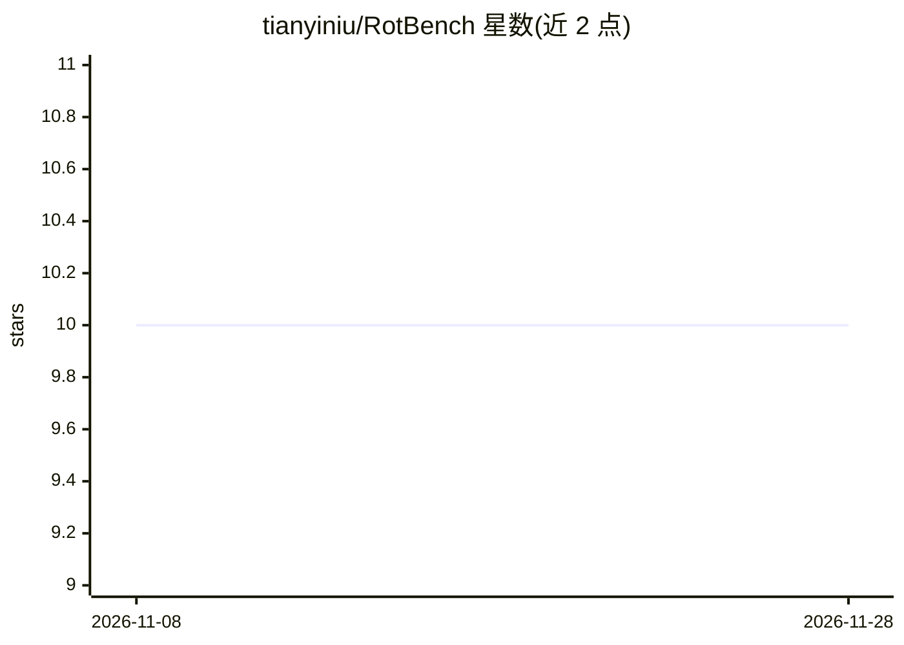

# tianyiniu/RotBench

⭐ 10 · Python · Apache-2.0 · 推送 2026-04-07 · [GitHub](https://github.com/tianyiniu/RotBench) · [官网](https://aclanthology.org/2026.eacl-long.259/) · 组织维护

**评测多模态大模型图像旋转识别能力的基准**

RotBench 是一个由 UNC Chapel Hill 团队发布的基准，评测多模态大语言模型识别输入图像 0°/90°/180°/270° 旋转的能力。包含 350 张人工筛选的图像（生活、人像、风景类），将旋转估计表示为多选题任务；支持提供字幕、深度图、分割图、场景图、边界框等辅助信息，以及思维链、旋转网格、多数投票等设置。代码以 Python 脚本组织，数据发布于 HuggingFace，附论文引用（EACL 2026）。

## 筛选速览

| 维度 | 判定 | 备注 |
|---|---|---|
| AI 角色 | `ai-knowledge` | 知识聚合/清单类 |
| 许可风险 | `permissive` | Apache-2.0 |
| 部署形态 | `None` |  |
| 模型依赖 | local-ok | 支持本地模型 |
| 硬件要求 | — | 无带数字的原话,不猜 |
| 安装摩擦 | `low` | 无编译、无系统依赖或容器化 |
| 成熟度 | — | 结构信号不足 |

## 能力要点

- 350 张人工筛选图像的旋转识别基准（0°/90°/180°/270°）
- 多种辅助信息提取脚本（字幕/深度图/分割图/场景图/边界框）
- 支持思维链、旋转网格、多数投票等评测设置
- 含 Qwen 微调实验流程（基于 MS COCO）

## 适用场景

- 评测多模态模型判断图像旋转方向的能力
- 研究空间推理任务中辅助信息的增益
- 复现论文实验或对比自研模型表现

## 场景标签

`模型评测` `多模态` · 领域:评测与运维

## 证据(README 行号)

> L9: We investigate to what extent Multimodal Large Language Models (MLLMs) can accurately identify the orientation of in
> L15: # Setup

## 星数曲线

2026-11-08 10 → 2026-11-28 10（+0）

---
*卡片 v1 · prompt 1.4 · 生成 2026-11-19 · 置信度 high · 依据 README sha `e9be5ad4c936` · [字段定义](../../DATASET.md)*
