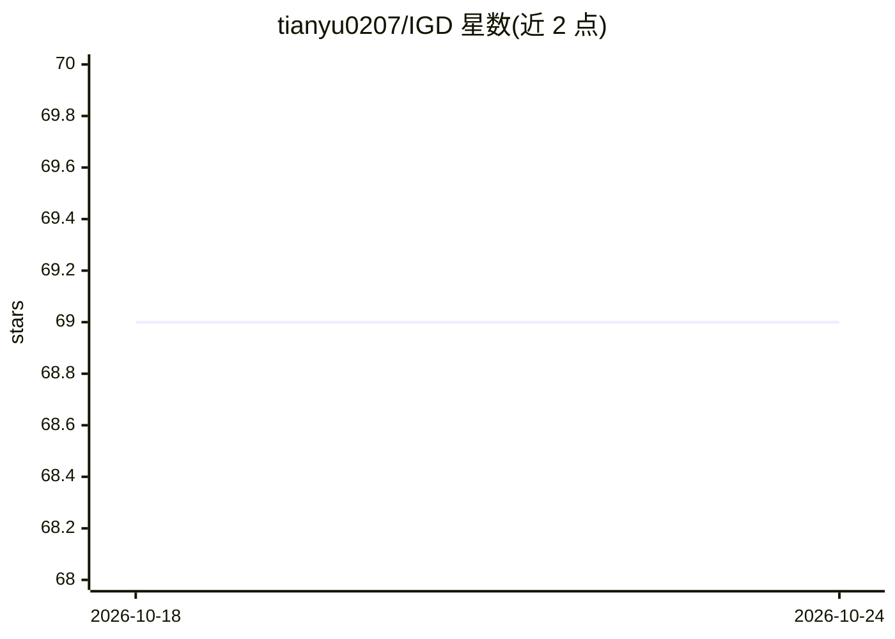

# tianyu0207/IGD

⭐ 69 · Python · 推送 2025-10-29 · [GitHub](https://github.com/tianyu0207/IGD) · 个人维护

**AAAI 2022 论文 IGD 的 PyTorch 官方实现：单类异常检测**

论文 'Deep One-Class Classification via Interpolated Gaussian Descriptor'（AAAI 2022 Oral）的官方 PyTorch 代码库。实现基于插值高斯描述子的深度单类分类方法，用于异常检测与异常分割；实验数据集为 MVTec AD 与 Hyper-Kvasir 胃肠道异常检测数据集，需用户自行下载。通过运行 job.sh 脚本训练/测试全局与局部模型。README 未列出依赖安装步骤与硬件要求。

## 筛选速览

| 维度 | 判定 | 备注 |
|---|---|---|
| AI 角色 | `ai-native` | 本体是模型或模型工具 |
| 许可风险 | `none` | — |
| 部署形态 | `None` |  |
| 模型依赖 | — | README 未给出锁定关系 |
| 硬件要求 | — | 无带数字的原话,不猜 |
| 安装摩擦 | `low` | 无编译、无系统依赖或容器化 |
| 成熟度 | — | 结构信号不足 |

## 能力要点

- AAAI 2022 Oral 论文的官方 PyTorch 实现
- 支持 MVTec AD 与 Hyper-Kvasir 两个异常检测数据集
- 提供 job.sh 一键训练/测试全局与局部模型

## 适用场景

- 复现论文的单类异常检测方法
- 在 MVTec AD 等数据集上做异常检测/分割实验
- 作为异常检测研究的基线代码

## 场景标签

 · 领域:计算机视觉/异常检测

## 证据(README 行号)

> L7: This repo contains the Pytorch implementation of our paper:
> L20: ## Train and Test IGD

## 星数曲线

2026-10-18 69 → 2026-10-24 69（+0）

---
*卡片 v1 · prompt 1.4 · 生成 2026-10-24 · 置信度 high · 依据 README sha `a8324141fb52` · [字段定义](../../DATASET.md)*
