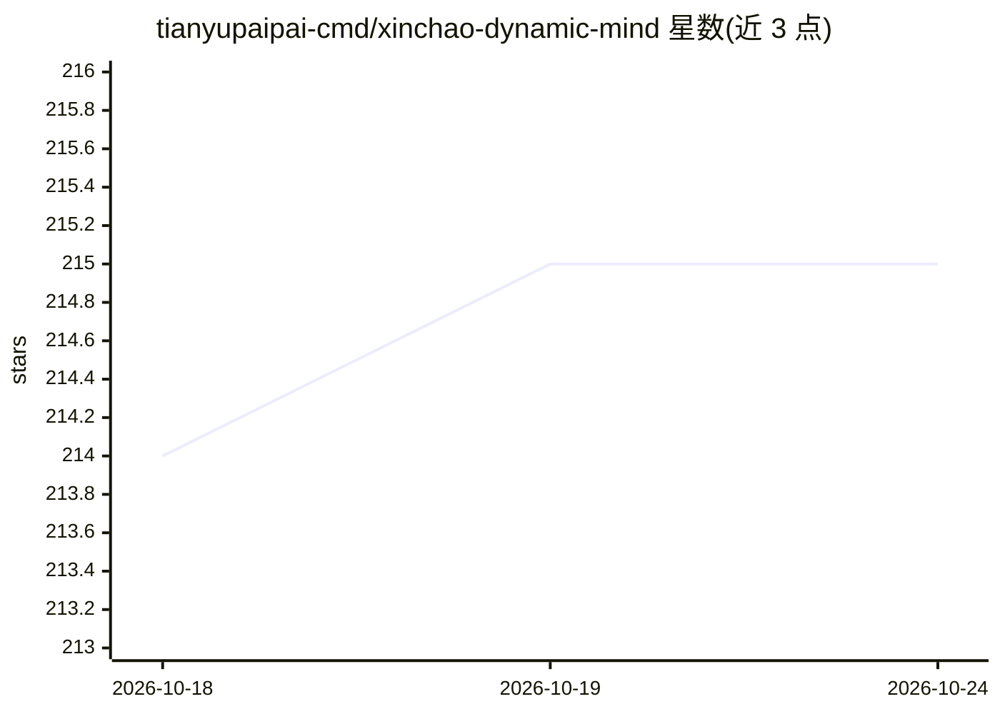

# tianyupaipai-cmd/xinchao-dynamic-mind

⭐ 215 · JavaScript · AGPL-3.0 · 推送 2026-09-04 · [GitHub](https://github.com/tianyupaipai-cmd/xinchao-dynamic-mind) · 个人维护 · 中文 README

**可自托管的 AI 动态状态层：驱动力、念头池与睡眠供多端接入**

面向 AI agent/前端的独立状态服务：在对话之外持续维护十二维驱动力、念头池、疲惫、睡眠、梦境余韵与短期窗口状态，通过 HTTP API、远程 MCP（含 OAuth 2.1）和用户互动连接桥接入 Claude、Codex、自建网页与移动端等终端。核心状态机可离线运行；模型、长期记忆、通知均为可选适配器，客户端只能提交有界语义互动、不能直接改数值。以 Node.js 服务形式提供，支持 Docker Compose 自托管。

## 筛选速览

| 维度 | 判定 | 备注 |
|---|---|---|
| AI 角色 | `ai-ecosystem` | LLM/agent 周边工具 |
| 许可风险 | `viral` | AGPL-3.0 |
| 部署形态 | `self-host` | docker 或自建部署 |
| 模型依赖 | — | README 未给出锁定关系 |
| 硬件要求 | — | 无带数字的原话,不猜 |
| 安装摩擦 | `low` | 无编译、无系统依赖或容器化 |
| 成熟度 | `idea` | |

## 能力要点

- 十二维驱动力、念头池、疲惫/睡眠/梦境余韵与意图选择的状态机
- HTTP API + Streamable HTTP MCP + OAuth 2.1 远程接入，多终端共享同一服务端
- 用户互动连接桥：耐久队列、SSE 通知、event_id 幂等与严格 ACK
- 隐私边界：不保存聊天正文，heartbeat 只发送 session_id 与不透明 event_id

## 适用场景

- 为自己的 AI 助手或 agent 附加持续演化的动态状态层
- 多终端（Claude、Codex、网页、手机）共享同一份状态数据
- 自托管一个可控的 AI 状态服务并接入可视化 Dashboard

## 场景标签

`Agent 记忆` · 领域:Agent 开发

## 证据(README 行号)

> L5: 心潮是一个独立、可自托管的 AI 动态状态层。它在对话之外持续维护驱动力、念头池、疲惫、睡眠、梦境余韵与短期窗口状态，并通过 HTTP API 或远程 MCP 接入不同模型、设备和前端。
> L47: - 标准远程 Streamable HTTP MCP；

## 星数曲线

2026-10-18 214 → 2026-10-24 215（+1）

---
*卡片 v1 · prompt 1.4 · 生成 2026-10-22 · 置信度 high · 依据 README sha `fe228dc53815` · [字段定义](../../DATASET.md)*
