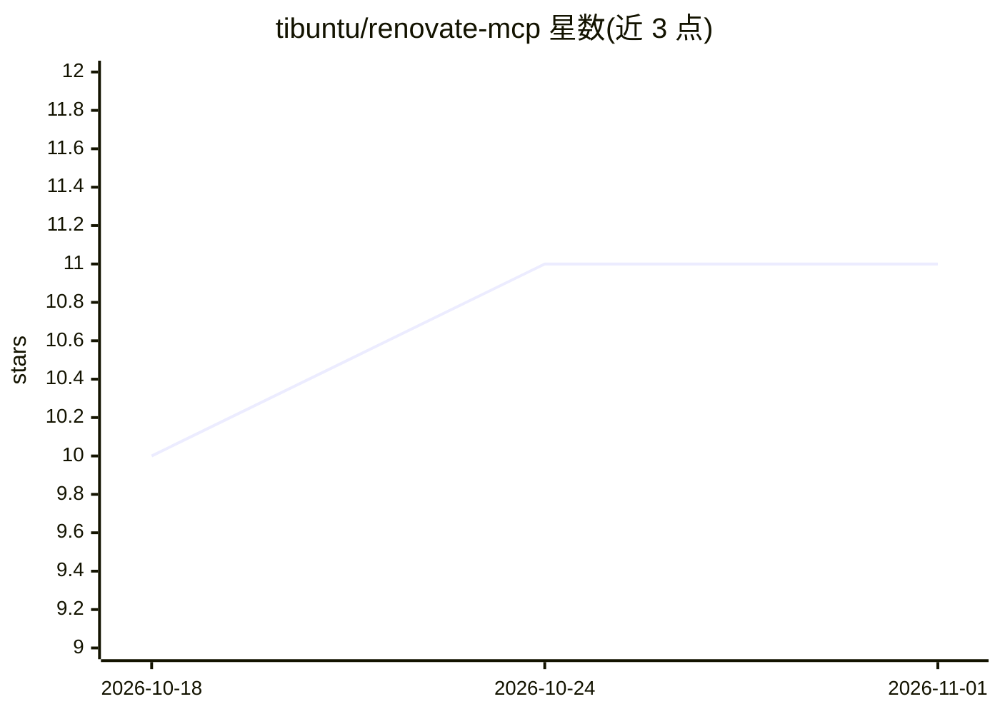

# tibuntu/renovate-mcp

⭐ 11 · TypeScript · MIT · 推送 2026-10-31 · [GitHub](https://github.com/tibuntu/renovate-mcp) · 个人维护

**交互式设计 Renovate 配置的 MCP 服务器**

面向使用 LLM 客户端（如 Claude Code）的开发者的 stdio MCP 服务器：指向本地仓库后，LLM 可读取、解析、离线展开 extends 预设、按自然语言意图推荐预设、预览 customManagers、做 schema 校验与语义 lint、执行 dry-run 并原子写回 renovate.json（保留注释与键序）。提供 18 个工具、7 个资源与 4 个工作流提示词。Renovate 作为运行时依赖打包（约 350 MB），离线工具无需 token；要求 Node.js ≥ 24.11，仅支持 Linux/macOS，Windows 需 WSL2。

## 筛选速览

| 维度 | 判定 | 备注 |
|---|---|---|
| AI 角色 | `ai-ecosystem` | LLM/agent 周边工具 |
| 许可风险 | `permissive` | MIT |
| 部署形态 | `self-host` | docker 或自建部署 |
| 模型依赖 | locked-api |  |
| 硬件要求 | — | 无带数字的原话,不猜 |
| 安装摩擦 | `low` | 无编译、无系统依赖或容器化 |
| 成熟度 | — | 结构信号不足 |

## 能力要点

- 18 个工具覆盖读取、预设发现、校验、lint、dry-run 与原子写回
- 多数工具离线运行，无需 token，不启动 Renovate 进程
- Renovate CLI 与校验器随包捆绑，开箱可用
- 4 个工作流提示词（配置设计、规则调试、自定义管理器编写、仓库接入）

## 适用场景

- 让 LLM 辅助为新仓库从零设计 renovate.json
- 解释现有配置中每个字段来自哪个预设
- dry-run 预览并解释依赖为何被更新或跳过

## 场景标签

`代码生成` · 领域:编码与开发

## 证据(README 行号)

> L8: An MCP server for designing Renovate configurations interactively. Point it at a local repo and let an LLM help you 
> L33: Eighteen tools, seven resources, and four workflow prompts. Each tool name below links to its full reference in `do

## 星数曲线

2026-10-18 10 → 2026-11-01 11（+1）

---
*卡片 v1 · prompt 1.4 · 生成 2026-11-01 · 置信度 high · 依据 README sha `858d93c4884e` · [字段定义](../../DATASET.md)*
