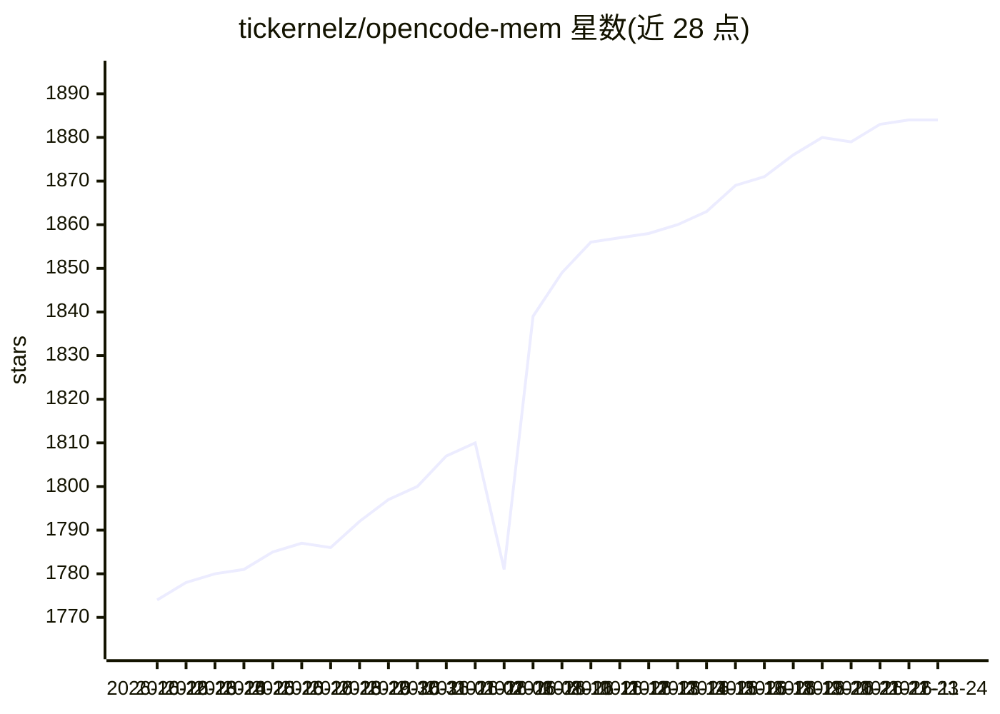

# tickernelz/opencode-mem

⭐ 1,884 · TypeScript · MIT · 推送 2026-11-18 · [GitHub](https://github.com/tickernelz/opencode-mem) · [官网](https://opencode-mem.zhafron.my.id) · 个人维护

**为 OpenCode 编码 agent 提供跨会话持久记忆的插件**

面向 OpenCode 编码 agent 的记忆插件：会话空闲时由后台 AI 请求自动抽取项目记忆，并在后续会话将相关记忆与用户画像注入模型上下文。内嵌 Turso/libSQL 数据库做向量检索（精确余弦距离），12+ 本地 CPU 嵌入模型或 OpenAI 兼容嵌入 API 可选。提供记忆去重、可恢复回收站、Markdown 导出导入、凭证脱敏与静态加密，附带 Web UI 管理记忆时间线与画像。以 npm 包形式安装，支持 OpenCode v1/v2 配置接入。

## 筛选速览

| 维度 | 判定 | 备注 |
|---|---|---|
| AI 角色 | `ai-ecosystem` | LLM/agent 周边工具 |
| 许可风险 | `permissive` | MIT |
| 部署形态 | `None` |  |
| 模型依赖 | — | README 未给出锁定关系 |
| 硬件要求 | — | 无带数字的原话,不猜 |
| 安装摩擦 | `low` | 无编译、无系统依赖或容器化 |
| 成熟度 | — | 结构信号不足 |

## 能力要点

- 内嵌 Turso/libSQL 向量检索，无需独立向量数据库
- 会话空闲时后台自动抽取记忆并注入模型上下文
- 捕获前凭证脱敏（GitHub token、API key、PEM 私钥等格式）与 <private> 标签保护
- 12+ 本地 CPU 嵌入模型，无需 GPU

## 适用场景

- 让编码 agent 跨会话记住项目上下文和我的偏好
- 在本地离线环境中为 agent 提供持久记忆
- 多项目管理用户画像与技能库，并通过 Web UI 查看记忆健康状态

## 场景标签

`Agent 记忆` · 领域:Agent 开发

## 证据(README 行号)

> L14: A persistent memory system for AI coding agents that enables long-term context retention across sessions using loca
> L23: - **Multi-provider AI support:** any provider configured in OpenCode (`opencodeProvider` / `opencodeModel`), or a m
> L78: - Auto-capture and user profile learning require an AI provider that can return structured/tool-call output. Memory

## 星数曲线

2026-10-22 1,774 → 2026-11-24 1,884（+110）

---
*卡片 v1 · prompt 1.4 · 生成 2026-11-23 · 置信度 high · 依据 README sha `f0b8bea0dda0` · [字段定义](../../DATASET.md)*
