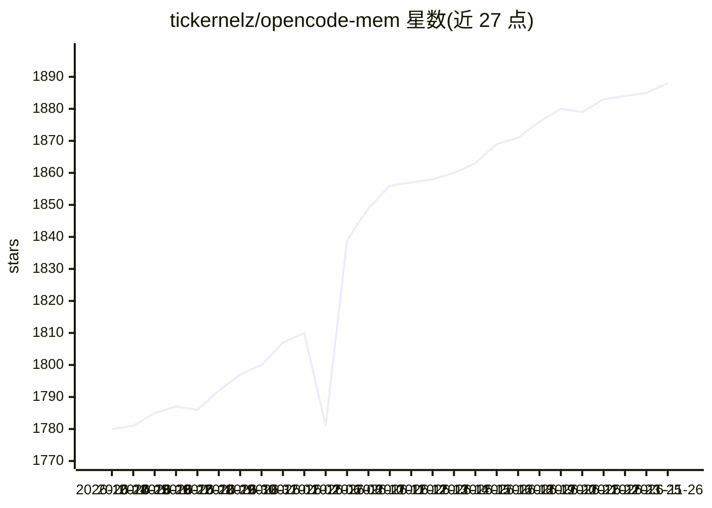

# tickernelz/opencode-mem

⭐ 1,888 · TypeScript · MIT · 推送 2026-11-24 · [GitHub](https://github.com/tickernelz/opencode-mem) · [官网](https://opencode-mem.zhafron.my.id) · 个人维护

**给 OpenCode 编码代理提供跨会话持久记忆的插件**

以 OpenCode 插件形式运行：会话空闲时由后台 AI 请求把技术工作提炼为项目记忆，检索相关记忆与用户画像注入模型上下文。内置嵌入式 Turso/libSQL 向量数据库做精确余弦检索，无需独立向量库；支持 12+ 个 CPU 本地嵌入模型或 OpenAI 兼容嵌入 API；提供 Web UI、可恢复回收站、Markdown vault、导出/导入迁移，并在写入前对凭据做脱敏。运行需 OpenCode 环境，推荐 Bun。

## 筛选速览

| 维度 | 判定 | 备注 |
|---|---|---|
| AI 角色 | `ai-ecosystem` | LLM/agent 周边工具 |
| 许可风险 | `permissive` | MIT |
| 部署形态 | `None` |  |
| 模型依赖 | — | README 未给出锁定关系 |
| 硬件要求 | — | 无带数字的原话,不猜 |
| 安装摩擦 | `low` | 无编译、无系统依赖或容器化 |
| 成熟度 | — | 结构信号不足 |

## 能力要点

- 嵌入式 Turso/libSQL 向量检索，无需独立向量数据库
- 自动记忆提取与召回，跨项目用户画像学习
- 12+ 本地 CPU 嵌入模型，无 GPU 需求
- 写入前凭据脱敏与 <private> 标签、可选静态加密

## 适用场景

- 让编码代理在多次会话间保留项目上下文和偏好
- 团队记录工作流模式并自动注入后续会话
- 本地保存敏感项目记忆并做凭据脱敏

## 场景标签

`Agent 记忆` · 领域:Agent 开发

## 证据(README 行号)

> L14: A persistent memory system for AI coding agents that enables long-term context retention across sessions using loca
> L18: - **Local database:** embedded Turso/libSQL with native vector search, stored under `storagePath`. No separate vect
> L23: - **Multi-provider AI support:** any provider configured in OpenCode (`opencodeProvider` / `opencodeModel`), or a m

## 星数曲线

2026-10-24 1,780 → 2026-11-26 1,888（+108）

---
*卡片 v1 · prompt 1.4 · 生成 2026-11-26 · 置信度 high · 依据 README sha `4d58dfd0bb47` · [字段定义](../../DATASET.md)*
