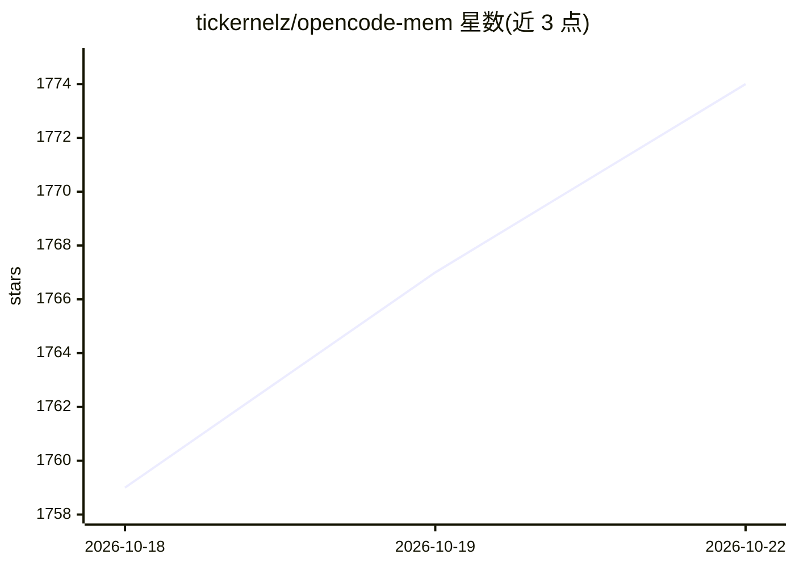

# tickernelz/opencode-mem

⭐ 1,774 · TypeScript · MIT · 推送 2026-10-21 · [GitHub](https://github.com/tickernelz/opencode-mem) · 个人维护 · 中文 README

**给 OpenCode 编码 agent 加持久记忆的向量数据库插件**

面向 OpenCode 编码 agent 的持久记忆插件：基于嵌入式 Turso/libSQL 本地向量数据库（F32_BLOB + 精确余弦搜索）存储跨会话记忆，支持会话空闲时自动提取记忆、用户画像学习、12+ 本地嵌入模型（CPU 运行、无需 GPU）与多 AI 提供商（OpenAI/Anthropic）自动捕获。提供 Web UI 浏览编辑、AES-256-GCM 静态加密与手动 memory 工具。限制：不支持 Intel Mac（无 x64 原生绑定），自动捕获需支持结构化/工具调用输出的提供商。

## 筛选速览

| 维度 | 判定 | 备注 |
|---|---|---|
| AI 角色 | `ai-ecosystem` | LLM/agent 周边工具 |
| 许可风险 | `permissive` | MIT |
| 部署形态 | `None` |  |
| 模型依赖 | — | README 未给出锁定关系 |
| 硬件要求 | — | 无带数字的原话,不猜 |
| 安装摩擦 | `low` | 无编译、无系统依赖或容器化 |
| 成熟度 | — | 结构信号不足 |

## 能力要点

- 嵌入式 Turso/libSQL 本地向量搜索，无需单独向量数据库
- 会话空闲时自动提取记忆并在后续会话注入上下文
- 12+ 本地嵌入模型经 @huggingface/transformers 在 CPU 运行
- Web UI（http://127.0.0.1:4747）浏览/编辑记忆与技能库

## 适用场景

- 让编码 agent 在不同会话间记住项目决策与排错经验
- 自动学习我的编码偏好供后续会话使用
- 手动存取和检索长期记忆（memory 工具）

## 场景标签

`Agent 记忆` · 领域:Agent 开发

## 证据(README 行号)

> L12: A persistent memory system for AI coding agents that enables long-term context retention across sessions using loca
> L16: Local Turso/libSQL database with native vector search, persistent project memories, automatic user profile learning

## 星数曲线

2026-10-18 1,759 → 2026-10-22 1,774（+15）

---
*卡片 v1 · prompt 1.4 · 生成 2026-10-21 · 置信度 high · 依据 README sha `f81c00ae1b12` · [字段定义](../../DATASET.md)*
