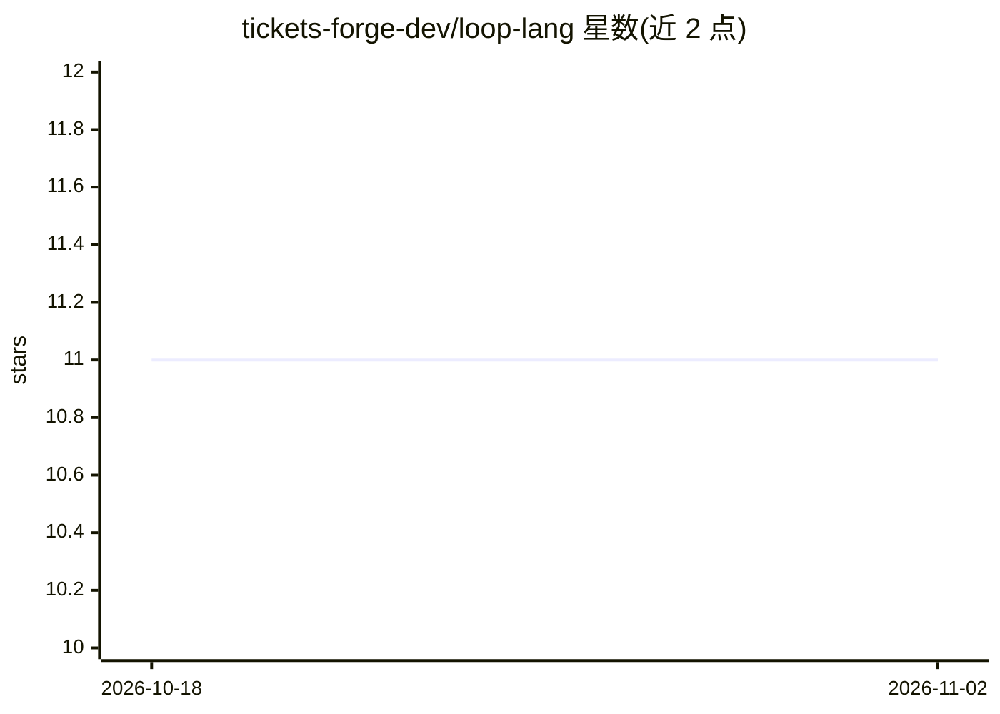

# tickets-forge-dev/loop-lang

⭐ 11 · TypeScript · NOASSERTION · 推送 2026-07-07 · [GitHub](https://github.com/tickets-forge-dev/loop-lang) · [官网](https://loopflow.live) · 个人维护

**用自然语言 DSL 描述 AI 编码循环直至验证通过**

开源自然语言 DSL：用英文写明 AI 编码 agent 应构建什么与如何验证，运行时驱动 plan→act→observe→reflect→stop 五阶段循环，检查通过才停止。可在 Claude Code、Cursor、Copilot 内运行，另提供 headless CLI（loop-run，含实时仪表盘、NDJSON 日志与断点续跑）和 VS Code 扩展。验证机制含 flake guard、多裁判 judge panel 与轨迹评审；默认 git 策略不推送 main。要求 Node 18+ 与 Claude Code CLI。

## 筛选速览

| 维度 | 判定 | 备注 |
|---|---|---|
| AI 角色 | `ai-ecosystem` | LLM/agent 周边工具 |
| 许可风险 | `permissive` | NOASSERTION |
| 部署形态 | `library` | 以包/库形式分发 |
| 模型依赖 | locked-api |  |
| 硬件要求 | — | 无带数字的原话,不猜 |
| 安装摩擦 | `low` | 无编译、无系统依赖或容器化 |
| 成熟度 | — | 结构信号不足 |

## 能力要点

- 自然语言 DSL 定义目标/验证/停止条件，循环直至检查通过
- 验证机制：flake guard、3 裁判多数判定、轨迹评审
- headless CLI loop-run：实时仪表盘、NDJSON 日志、resume 断点续跑
- 循环可组合为 pipeline/flow/for each，支持技能调用与跨运行记忆

## 适用场景

- 让 AI 编码 agent 反复迭代直到测试变绿，无需人工盯守
- 把可复用的编码任务写成可分享、可编辑的 .loop 文件
- 在 CI 或本地 headless 运行带日志与断点续跑的 agent 流水线

## 场景标签

`Agent 框架` `编码 Agent` · 领域:Agent 开发

## 证据(README 行号)

> L5:  An open, natural-language DSL for self-correcting AI coding loops. Describe what an AI coding agent should build an
> L112: |`@loop-lang/runtime`|walks a spec, drives Claude Code, emits a live trace|

## 星数曲线

2026-10-18 11 → 2026-11-02 11（+0）

---
*卡片 v1 · prompt 1.4 · 生成 2026-11-01 · 置信度 high · 依据 README sha `d955230720c2` · [字段定义](../../DATASET.md)*
