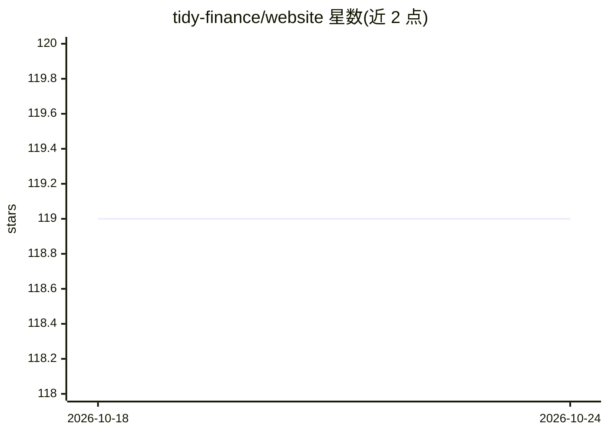

# tidy-finance/website

⭐ 119 · HTML · NOASSERTION · 推送 2026-09-14 · [GitHub](https://github.com/tidy-finance/website) · [官网](https://tidy-finance.org) · 组织维护

**tidy-finance.org 网站源码：两本金融编程书籍与博客的站点仓库**

托管 tidy-finance.org 网站的源码仓库，内容整合两本书籍《Tidy Finance with R》与《Tidy Finance with Python》（作者来自维也纳经济大学等，已由 Chapman & Hall / CRC 出版纸质版）以及开放投稿的 Tidy Finance Blog。网站使用 Quarto 渲染并通过 GitHub Pages 托管，代码以 CC BY-NC-SA 4.0 许可发布。仓库另指向 tidyfinance R 包的独立 GitHub 仓库。面向金融学习与研究者。

## 筛选速览

| 维度 | 判定 | 备注 |
|---|---|---|
| AI 角色 | `ai-knowledge` | 知识聚合/清单类 |
| 许可风险 | `none` | NOASSERTION |
| 部署形态 | `None` |  |
| 模型依赖 | — | README 未给出锁定关系 |
| 硬件要求 | — | 无带数字的原话,不猜 |
| 安装摩擦 | `low` | 无编译、无系统依赖或容器化 |
| 成熟度 | — | 结构信号不足 |

## 能力要点

- 整合 R 与 Python 两本 Tidy Finance 书籍及开放投稿博客
- 网站由 Quarto 渲染，托管于 GitHub Pages
- 代码采用 CC BY-NC-SA 4.0 许可
- 指向独立的 tidyfinance R 包仓库

## 适用场景

- 在线阅读 Tidy Finance 的 R/Python 教程与博客
- 为网站内容提交修改或向博客投稿
- 查找 tidyfinance R 包的入口

## 场景标签

`金融量化` `教程课程` · 领域:学习与行业

## 证据(README 行号)

> L3: This is the repository for the website tidy-finance.org combining
> L4: - The book **Tidy Finance with R** by Christoph Scheuch, Stefan Voigt, and Patrick Weiss,
> L5: - The book **Tidy Finance with Python** by Christoph Frey, Christoph Scheuch, Stefan Voigt, and Patrick Weiss, and

## 星数曲线

2026-10-18 119 → 2026-10-24 119（+0）

---
*卡片 v1 · prompt 1.4 · 生成 2026-10-23 · 置信度 high · 依据 README sha `28a6baca3b6b` · [字段定义](../../DATASET.md)*
