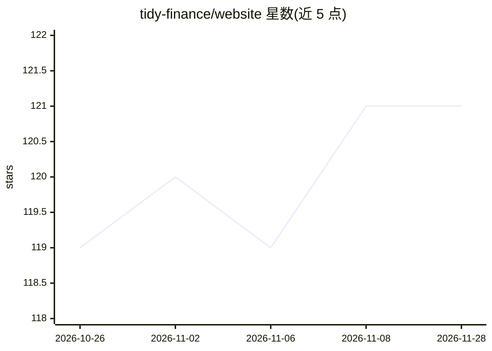

# tidy-finance/website

⭐ 121 · HTML · NOASSERTION · 推送 2026-11-25 · [GitHub](https://github.com/tidy-finance/website) · [官网](https://tidy-finance.org) · 组织维护

**Tidy Finance 两本量化金融书籍与博客的网站源码**

托管 tidy-finance.org 的源码，聚合《Tidy Finance with R》《Tidy Finance with Python》两本书与开放投稿的博客内容，主题覆盖资产定价、tidyverse 数据处理与机器学习等。网站用 Quarto 渲染并发布于 GitHub Pages，README 提供本地渲染流程：R 依赖由 uvr 管理、Python 依赖由 uv 管理，含 Windows 的 PowerShell 激活方式与安装失败的处理提示。代码以 CC BY-NC-SA 4.0 许可发布，纸质书经 Chapman & Hall / CRC 出版。

## 筛选速览

| 维度 | 判定 | 备注 |
|---|---|---|
| AI 角色 | `ai-knowledge` | 知识聚合/清单类 |
| 许可风险 | `none` | NOASSERTION |
| 部署形态 | `None` |  |
| 模型依赖 | — | README 未给出锁定关系 |
| 硬件要求 | — | 无带数字的原话,不猜 |
| 安装摩擦 | `low` | 无编译、无系统依赖或容器化 |
| 成熟度 | — | 结构信号不足 |

## 能力要点

- 托管两本 Tidy Finance 书籍（R 与 Python 版）与博客的网站源码
- Quarto 渲染 + GitHub Pages 托管，本地渲染流程完整
- R 与 Python 依赖分别由 uvr 与 uv 锁定管理

## 适用场景

- 本地渲染 Tidy Finance 网站与书籍内容
- 为 Tidy Finance 博客投稿
- 查阅 R/Python 量化金融的代码示例来源

## 场景标签

`金融量化` `教程课程` · 领域:学习与行业

## 证据(README 行号)

> L3: This is the repository for the website tidy-finance.org combining
> L4: - The book **Tidy Finance with R** by Christoph Scheuch, Stefan Voigt, and Patrick Weiss,
> L8: The code is licensed under Creative Commons Attribution-NonCommercial-ShareAlike 4.0 International CC BY-NC-SA 4.0. 

## 星数曲线

2026-10-26 119 → 2026-11-28 121（+2）

---
*卡片 v1 · prompt 1.4 · 生成 2026-11-28 · 置信度 high · 依据 README sha `f4f52dac815a` · [字段定义](../../DATASET.md)*
