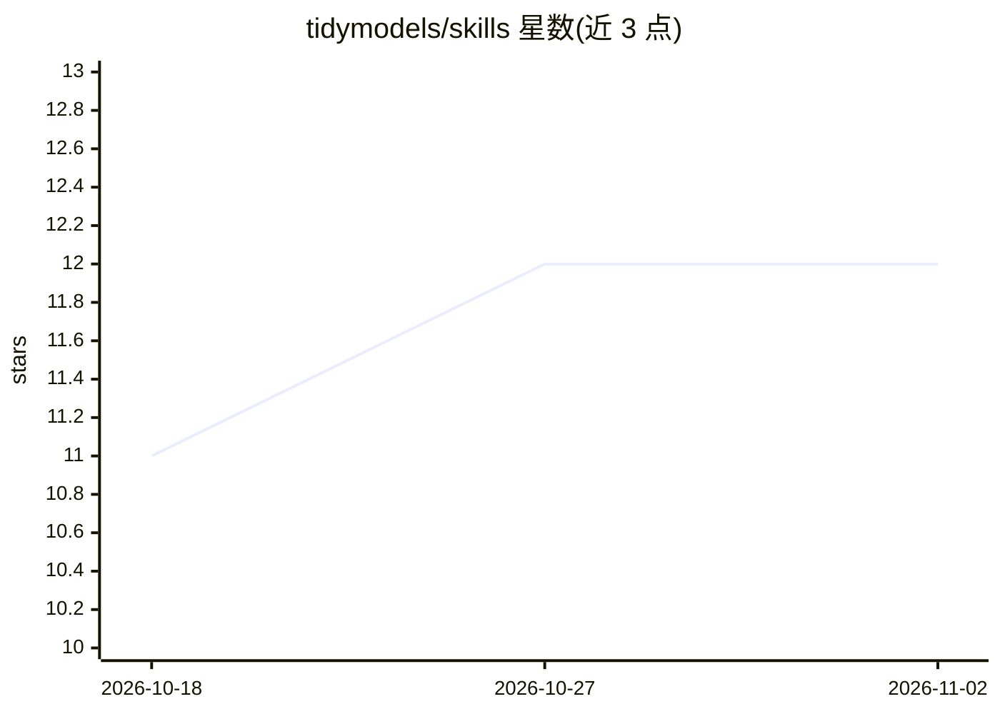

# tidymodels/skills

⭐ 12 · Python · 推送 2026-08-28 · [GitHub](https://github.com/tidymodels/skills) · [官网](https://skills.tidymodels.org/) · 组织维护

**面向 Tidymodels 生态的官方 Claude Code 技能集**

由 Tidymodels 团队维护的 Claude Code 技能仓库，按受众分两类：开发者技能覆盖创建自定义 yardstick 度量、编写 recipes 预处理步骤、参与 Tidymodels 包贡献；用户技能覆盖表格数据机器学习工作流、模型训练调参评估与特征工程。通过 Claude Code 插件市场安装，需在 Claude Code 中激活技能以获得 Tidymodels 开发辅助。提供在线文档站与分类浏览入口。

## 筛选速览

| 维度 | 判定 | 备注 |
|---|---|---|
| AI 角色 | `ai-knowledge` | 知识聚合/清单类 |
| 许可风险 | `permissive` | — |
| 部署形态 | `None` |  |
| 模型依赖 | locked-api |  |
| 硬件要求 | — | 无带数字的原话,不猜 |
| 安装摩擦 | `low` | 无编译、无系统依赖或容器化 |
| 成熟度 | — | 结构信号不足 |

## 能力要点

- 按开发者/用户两类受众组织的技能集
- 开发者技能：自定义 yardstick 度量、recipes 步骤、包贡献
- 用户技能：表格数据 ML 工作流、训练调参评估、特征工程
- 通过 Claude Code 插件市场一键安装

## 适用场景

- 在 Claude Code 中获得 Tidymodels 建模工作流辅助
- 为 Tidymodels 包开发自定义度量与预处理步骤时获取指导
- 学习 Tidymodels 工作流与最佳实践

## 场景标签

 · 领域:机器学习/R 语言工具

## 证据(README 行号)

> L3: Official Claude Code skills for the Tidymodels ecosystem, organized by audience.
> L25: This repository contains two categories of skills:
> L39: Skills for **using** Tidymodels in data analysis and modeling:

## 星数曲线

2026-10-18 11 → 2026-11-02 12（+1）

---
*卡片 v1 · prompt 1.4 · 生成 2026-10-31 · 置信度 high · 依据 README sha `bb661191f83c` · [字段定义](../../DATASET.md)*
