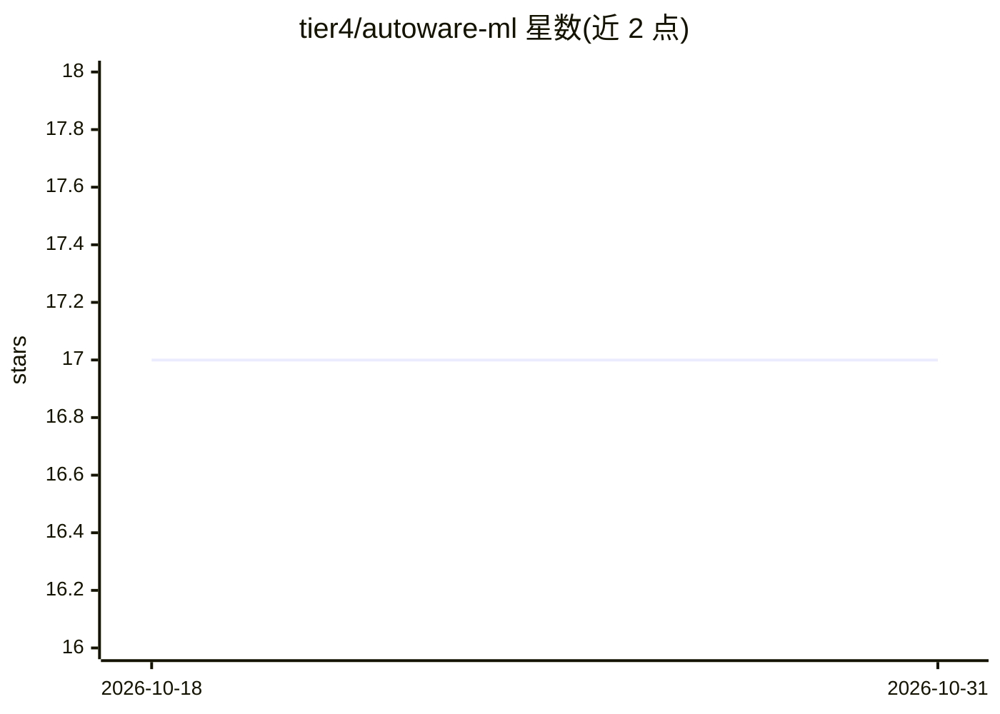

# tier4/autoware-ml

⭐ 17 · Python · Apache-2.0 · 推送 2026-10-30 · [GitHub](https://github.com/tier4/autoware-ml) · [官网](https://tier4.github.io/autoware-ml/) · 组织维护

**面向 Autoware 的机器学习框架：覆盖训练到部署全流程**

Autoware-ML 是 Autoware 自动驾驶开源栈配套的机器学习框架，支持模型训练、评测、优化与部署的完整生命周期，并在 Autoware 中提供原生运行时支持。README 标注项目处于 Early Alpha 阶段，将取代 tier4/AWML，文档发布于 tier4.github.io/autoware-ml。README 本身较短，未包含安装命令与使用说明。

## 筛选速览

| 维度 | 判定 | 备注 |
|---|---|---|
| AI 角色 | `ai-ecosystem` | LLM/agent 周边工具 |
| 许可风险 | `permissive` | Apache-2.0 |
| 部署形态 | `None` |  |
| 模型依赖 | — | README 未给出锁定关系 |
| 硬件要求 | — | 无带数字的原话,不猜 |
| 安装摩擦 | `low` | 无编译、无系统依赖或容器化 |
| 成熟度 | `idea` | |

## 能力要点

- 支持训练、评测、优化、部署的模型全生命周期
- 模型在 Autoware 中有原生运行时支持
- 项目自述将取代 tier4/AWML

## 适用场景

- 为 Autoware 自动驾驶系统训练和部署感知模型
- 在 Autoware 生态内做模型评测与优化

## 场景标签

`模型训练` `模型评测` · 领域:评测与运维

## 证据(README 行号)

> L3: Machine learning framework for Autoware.
> L5: Early Alpha version. This project will replace tier4/AWML.

## 星数曲线

2026-10-18 17 → 2026-10-31 17（+0）

---
*卡片 v1 · prompt 1.4 · 生成 2026-10-29 · 置信度 low · 依据 README sha `aebc23bd6218` · [字段定义](../../DATASET.md)*
