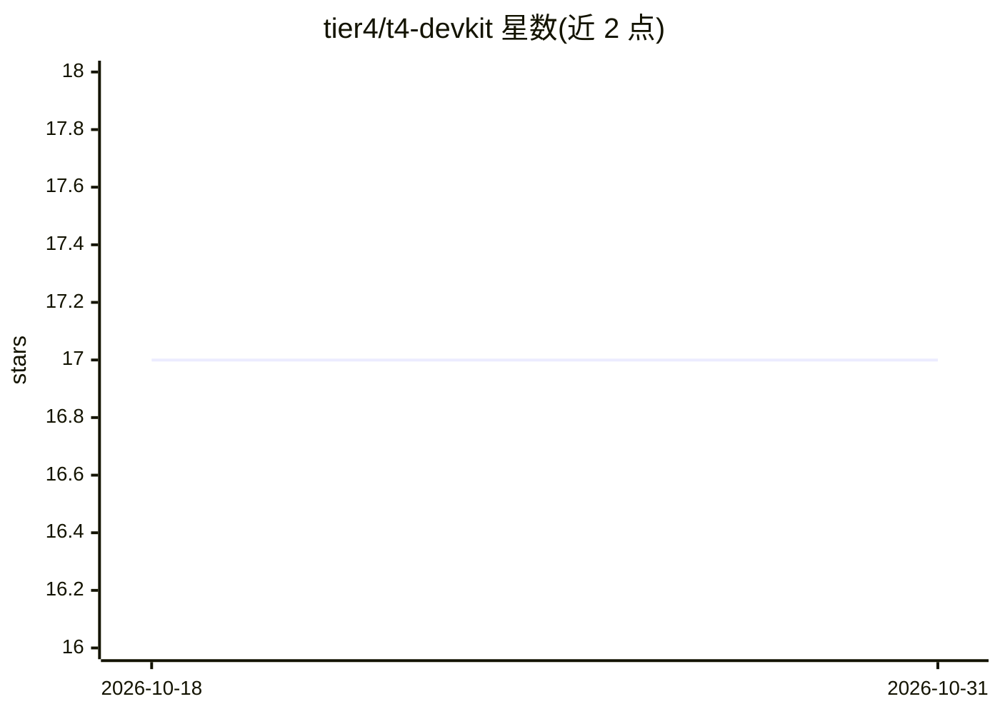

# tier4/t4-devkit

⭐ 17 · Python · Apache-2.0 · 推送 2026-10-28 · [GitHub](https://github.com/tier4/t4-devkit) · [官网](https://tier4.github.io/t4-devkit/) · 组织维护

**自动驾驶 T4 数据集的加载与操作工具包**

TIER4 维护的 Python 工具包，用于加载和操作 T4 自动驾驶数据集：提供 3D 框、点云分割、3D 轨迹、TF 链接、2D 框、图像分割、矢量地图与自车位置等可视化能力（t4viz CLI/API），以及数据正确性检查（t4sanity CLI/API）。面向使用 Autoware 生态 T4 数据集的开发者，通过 pip 从 GitHub 安装，开发者可用 uv 从源码构建。

## 筛选速览

| 维度 | 判定 | 备注 |
|---|---|---|
| AI 角色 | `ai-ecosystem` | LLM/agent 周边工具 |
| 许可风险 | `permissive` | Apache-2.0 |
| 部署形态 | `library` | 以包/库形式分发 |
| 模型依赖 | — | README 未给出锁定关系 |
| 硬件要求 | — | 无带数字的原话,不猜 |
| 安装摩擦 | `low` | 无编译、无系统依赖或容器化 |
| 成熟度 | — | 结构信号不足 |

## 能力要点

- 3D/2D/地图多维数据可视化（t4viz）
- 数据正确性检查工具（t4sanity）
- 提供 CLI 与 API 两种使用方式
- 支持 pip 从 GitHub 安装指定分支或标签

## 适用场景

- 浏览和检查 T4 自动驾驶数据集内容
- 在训练/评测流程前做数据完整性检查
- 复用 API 二次开发数据集处理脚本

## 场景标签

 · 领域:自动驾驶/数据集工具

## 证据(README 行号)

> L3: A toolkit to load and operate T4 dataset.
> L53: `t4-devkit` provides a set of visualization tools to help you understand the data.

## 星数曲线

2026-10-18 17 → 2026-10-31 17（+0）

---
*卡片 v1 · prompt 1.4 · 生成 2026-10-29 · 置信度 high · 依据 README sha `8f40c3ecacac` · [字段定义](../../DATASET.md)*
