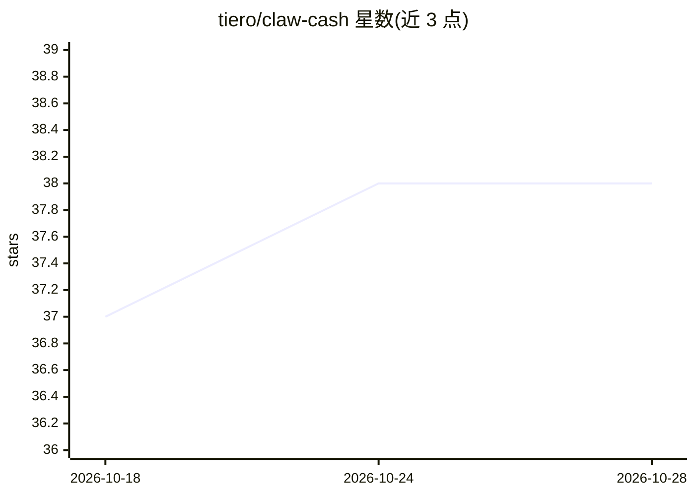

# tiero/claw-cash

⭐ 38 · TypeScript · MIT · 推送 2026-07-24 · [GitHub](https://github.com/tiero/claw-cash) · [官网](https://clw.cash) · 个人维护

**为 AI agent 提供比特币钱包：稳定币进、BTC 出、密钥入隔离区**

面向 AI agent 的比特币钱包工具链：提供 cash CLI（输出 JSON 供 agent 子进程调用）、TypeScript SDK、REST API 与 Evervault Enclave 签名服务。agent 收到人类支付的稳定币（USDC/USDT）后经 LendaSwap/Boltz 换成 BTC 持有，支出时再即时换回稳定币；私钥由硬件隔离 Enclave 或 Cloudflare Worker（AES-256-GCM）管理，支持 Lightning/Ark，配 Telegram 2FA、审计日志与速率限制。兼容 OpenClaw、Claude Code 等 agent 框架；原生 x402 支付与 MCP server 尚在路线图。

## 筛选速览

| 维度 | 判定 | 备注 |
|---|---|---|
| AI 角色 | `ai-ecosystem` | LLM/agent 周边工具 |
| 许可风险 | `permissive` | MIT |
| 部署形态 | `library` | 以包/库形式分发 |
| 模型依赖 | — | README 未给出锁定关系 |
| 硬件要求 | — | 无带数字的原话,不猜 |
| 安装摩擦 | `low` | 无编译、无系统依赖或容器化 |
| 成熟度 | — | 结构信号不足 |

## 能力要点

- cash CLI 输出 JSON，供 AI agent 作为子进程工具调用
- 私钥由 Evervault 硬件隔离 Enclave 或 Cloudflare Worker 两种模式管理
- 稳定币↔BTC 即时互换（LendaSwap + Boltz），覆盖 BTC/Lightning/Ark/稳定币
- factory bot 模式：Telegram 机器人经 API key 为其用户分配钱包

## 适用场景

- 给我的 AI agent 一个可自主收付的比特币钱包
- 通过 Telegram bot 给多个用户提供比特币钱包服务
- agent 用稳定币支付 API、x402 付费资源

## 场景标签

 · 领域:加密货币/AI agent 基础设施

## 证据(README 行号)

> L7: Agents hold Bitcoin — the only money they can cryptographically verify. When they need to pay for something (APIs, s
> L9: Works with any agent harness — OpenClaw, Claude Code, or your own. Give your agent a wallet it can actually verify.

## 星数曲线

2026-10-18 37 → 2026-10-28 38（+1）

---
*卡片 v1 · prompt 1.4 · 生成 2026-10-25 · 置信度 high · 依据 README sha `07c009dc86d5` · [字段定义](../../DATASET.md)*
