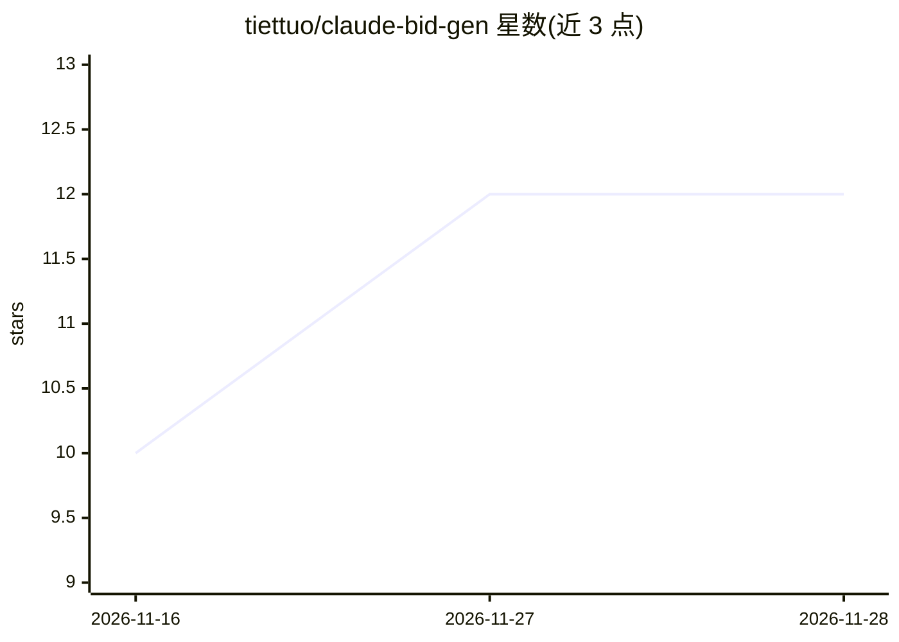

# tiettuo/claude-bid-gen

⭐ 12 · Python · MIT · 推送 2026-11-02 · [GitHub](https://github.com/tiettuo/claude-bid-gen) · 个人维护 · 中文 README

**给工程投标方用 AI 管道生成施工组织设计技术标**

面向工程类招投标的施工组织设计生成管道：从招标 PDF/DOCX/XLSX 抽取关键信息（评分办法、强制大纲、废标条款），经 LLM 生成项目脑图与章节计划，再批量撰写章节、审校分级、组装为 docx，并执行合规检查与多家投标文件的相似度防围标检测。以 26 个 Python 脚本 + 主提示词构成，可移植到 Claude Code/Codex/pi/hermas 等支持 prompt 与 bash 工具调用的智能体；Step 2 需 LLM 在对话中手工完成，脚本带 checkpoint 断点机制。

## 筛选速览

| 维度 | 判定 | 备注 |
|---|---|---|
| AI 角色 | `ai-native` | 本体是模型或模型工具 |
| 许可风险 | `permissive` | MIT |
| 部署形态 | `library` | 以包/库形式分发 |
| 模型依赖 | — | README 未给出锁定关系 |
| 硬件要求 | — | 无带数字的原话,不猜 |
| 安装摩擦 | `low` | 无编译、无系统依赖或容器化 |
| 成熟度 | — | 结构信号不足 |

## 能力要点

- Extract→plan→write→assemble→compliance 六步管道，含 checkpoint 状态管理
- 章节锚点取自评分表/施组大纲的语义并集去重，禁止自造标题
- 批量投标变体生成与相似度矩阵防围标检查
- 主提示词采用 Claude Code slash command 格式，可移植到其他 agent

## 适用场景

- 为投标项目从招标文件生成施工组织设计初稿
- 投标前对技术标做合规检查与废标风险排查
- 多标段批量投标时检查文件间相似度

## 场景标签

`文档解析` `AI 写作` · 领域:内容生成

## 证据(README 行号)

> L5: 工程类招投标的全流程施工组织设计生成管道，从原始招标 PDF/DOCX 抽取，到机器审校 + 合规检查 + 批量投标相似度防围标。
> L7: **当前形态**：脚本管道 + 智能体编排。可移植到任何支持 prompt + bash 工具调用的智能体（Claude Code / Codex / pi / hermas 等）。

## 星数曲线

2026-11-16 10 → 2026-11-28 12（+2）

---
*卡片 v1 · prompt 1.4 · 生成 2026-11-19 · 置信度 high · 依据 README sha `f51481e995e3` · [字段定义](../../DATASET.md)*
