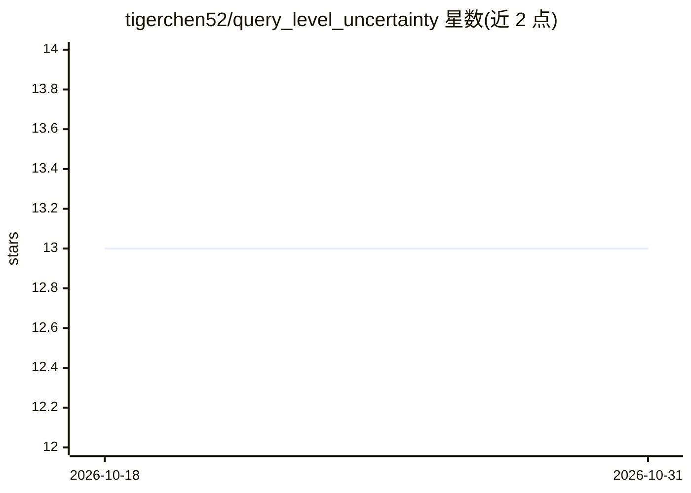

# tigerchen52/query_level_uncertainty

⭐ 13 · Python · MIT · 推送 2026-03-27 · [GitHub](https://github.com/tigerchen52/query_level_uncertainty) · 个人维护

**LLM 查询级不确定性估计方法库，单次前向传播出置信度**

论文 'Query-Level Uncertainty in Large Language Models' 的官方代码库，提出 Internal Confidence 方法：无需训练样本，仅对给定查询做单次前向传播（不生成任何 token）即估计不确定性。基于 transformers 加载模型（示例含 Phi-3、Qwen2.5），以 pip 包 query-level-uncertainty 提供 Python API；eval_ql_uncertainty 目录含复现论文表 1 与图 6 的脚本，方法可应用于自适应推理（RAG、模型级联、弃答等）。

## 筛选速览

| 维度 | 判定 | 备注 |
|---|---|---|
| AI 角色 | `ai-ecosystem` | LLM/agent 周边工具 |
| 许可风险 | `permissive` | MIT |
| 部署形态 | `library` | 以包/库形式分发 |
| 模型依赖 | — | README 未给出锁定关系 |
| 硬件要求 | — | 无带数字的原话,不猜 |
| 安装摩擦 | `low` | 无编译、无系统依赖或容器化 |
| 成熟度 | — | 结构信号不足 |

## 能力要点

- Training-free：无需训练样本
- 单次前向传播估计不确定性，不生成 token
- 提供 pip 包与论文结果复现脚本
- 展示高效 RAG 与模型级联等自适应推理应用

## 适用场景

- 在调用检索或更大模型前评估查询置信度以控制成本
- 复现论文的不确定性估计实验结果
- 构建模型级联或弃答策略的置信度信号

## 场景标签

`模型评测` · 领域:评测与运维

## 证据(README 行号)

> L6: This is the repo for our work "Query-Level Uncertainty in Large Language Models". Our proposed **Internal Confidence
> L26: ## Reproduction

## 星数曲线

2026-10-18 13 → 2026-10-31 13（+0）

---
*卡片 v1 · prompt 1.4 · 生成 2026-10-31 · 置信度 high · 依据 README sha `bcc9e5abd485` · [字段定义](../../DATASET.md)*
