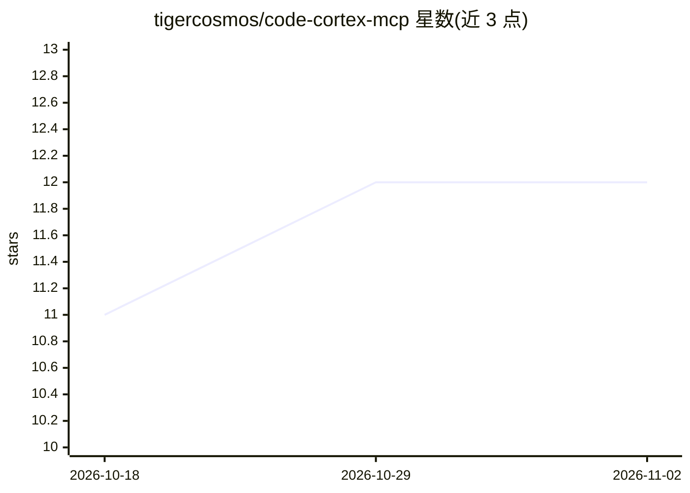

# tigercosmos/code-cortex-mcp

⭐ 12 · C++ · MIT · 推送 2026-10-19 · [GitHub](https://github.com/tigercosmos/code-cortex-mcp) · [官网](https://tigercosmos.github.io/code-cortex-mcp/) · 个人维护

**为 AI 编码 agent 提供代码库调用图索引的本地 MCP 服务器**

code-cortex-mcp 是一个本地 MCP 服务器，把代码库索引为可查询的知识图（函数、类、调用图、HTTP 路由、跨服务链接），供 Claude Code、Codex CLI、Gemini CLI 等 AI 编码 agent 使用，替代反复 grep-and-read。基于 tree-sitter 解析 155 种语言，对 10 种语言做类型解析，无需 LLM 与 API key，数据以 SQLite 存于本地缓存。以单个静态二进制发布，安装脚本同时配置 MCP 客户端的 hooks（SessionStart/PreToolUse/PostToolUse/UserPromptSubmit）。由 codebase-memory-mcp fork 而来。

## 筛选速览

| 维度 | 判定 | 备注 |
|---|---|---|
| AI 角色 | `ai-ecosystem` | LLM/agent 周边工具 |
| 许可风险 | `permissive` | MIT |
| 部署形态 | `self-host` | docker 或自建部署 |
| 模型依赖 | — | README 未给出锁定关系 |
| 硬件要求 | — | 无带数字的原话,不猜 |
| 安装摩擦 | `low` | 无编译、无系统依赖或容器化 |
| 成熟度 | — | 结构信号不足 |

## 能力要点

- tree-sitter 解析 155 种语言，10 种语言解析析类型与调用关系
- 单个静态二进制，无运行时依赖，无需 LLM 与 API key
- 提供 inspect_symbol/trace_path/query_graph 等 MCP 工具，均可从 CLI 调用
- 每个 checkout/branch 独立索引，索引结果可复现，支持提交压缩快照供团队复用

## 适用场景

- 让 AI 编码 agent 通过调用图定位定义、调用者与调用链
- 查询签名变更的影响范围（git diff blast radius）
- 追踪跨服务 HTTP/gRPC/pub-sub 调用链路

## 场景标签

 · 领域:开发者工具/AI 编码基础设施

## 证据(README 行号)

> L24: **code-cortex-mcp** is a local MCP server for AI coding
> L26: routes, and cross-service links. Graph queries can replace repeated grep-and-read cycles when
> L53: The installer configures Claude Code, Codex CLI, Gemini CLI, Zed, OpenCode, Aider, VS Code,

## 星数曲线

2026-10-18 11 → 2026-11-02 12（+1）

---
*卡片 v1 · prompt 1.4 · 生成 2026-10-31 · 置信度 mid · 依据 README sha `e2fbc5b1793b` · [字段定义](../../DATASET.md)*
