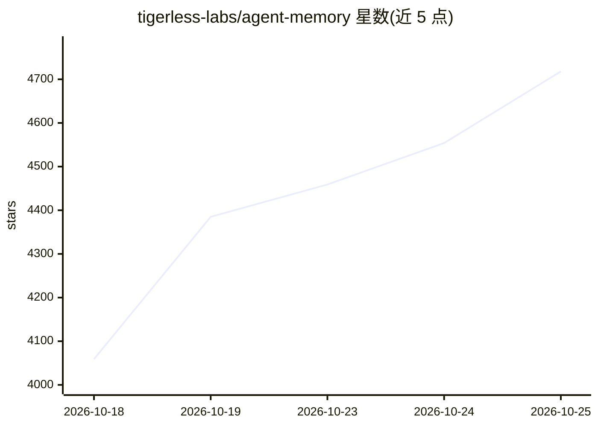

# tigerless-labs/agent-memory

⭐ 4,718 · Python · MIT · 推送 2026-10-22 · [GitHub](https://github.com/tigerless-labs/agent-memory) · 组织维护

**面向 AI agent 的长期记忆运行时，Markdown 为唯一事实源**

为任意可执行 shell 命令的 agent（Claude Code、Codex CLI、Muse Code 等）提供共享的本地长期记忆存储：一条记忆一个 Markdown 文件，SQLite/FTS5 索引仅作可重建缓存。检索为本地 ranked（BM25 加可选向量插件 RRF 融合），以路径而非粘贴文本返回；写入在会话边界自动触发蒸馏，睡眠期 Manage 层按自身节拍做合并与按值遗忘（删除仅为提案）。库内无 LLM 客户端，推理借用宿主 agent 的 CLI，无需 API key。需 Python 3.12+ 与 uv，从 git checkout 源码安装，PyPI 尚无发布；另提供 MCP 服务器（mem-mcp）与生命周期钩子（mem-hook）。

## 筛选速览

| 维度 | 判定 | 备注 |
|---|---|---|
| AI 角色 | `ai-ecosystem` | LLM/agent 周边工具 |
| 许可风险 | `permissive` | MIT |
| 部署形态 | `library` | 以包/库形式分发 |
| 模型依赖 | — | README 未给出锁定关系 |
| 硬件要求 | — | 无带数字的原话,不猜 |
| 安装摩擦 | `low` | 无编译、无系统依赖或容器化 |
| 成熟度 | `idea` | |

## 能力要点

- Markdown 文件为唯一事实源，索引可随时删除并以 mem rebuild 无损重建
- L0 列表→摘要→全文→原始消息的分级读取，检索返回路径而非粘贴文本
- 会话边界自动蒸馏写入与睡眠期 Manage 层（无值守操作只能新增/更新，删除以提案形式确认）
- 库内零 LLM 客户端、零 API key，Write/Manage 推理策略可按操作独立配置

## 适用场景

- 让 Claude Code 与 Codex 等 agent 共享同一份跨会话记忆存储
- 为经常遗忘会话所学内容的 agent 建立可 grep、可 git、可迁移的记忆层
- 按时间点回溯（recall --as-of）与追溯记忆来源（trace 引用原始消息）

## 场景标签

`Agent 记忆` · 领域:Agent 开发

## 证据(README 行号)

> L5: An agent that closes its session forgets everything it learned in it. agent-memory is the
> L65: - **No LLM client inside the library.** Zero keys to install and no billing surface: judgement
> L199: Pass `--mcp` to setup when the host should also receive the `agent-memory` stdio MCP server.

## 星数曲线

2026-10-18 4,059 → 2026-10-25 4,718（+659）

---
*卡片 v1 · prompt 1.4 · 生成 2026-10-20 · 置信度 mid · 依据 README sha `a9eef62f2a32` · [字段定义](../../DATASET.md)*
