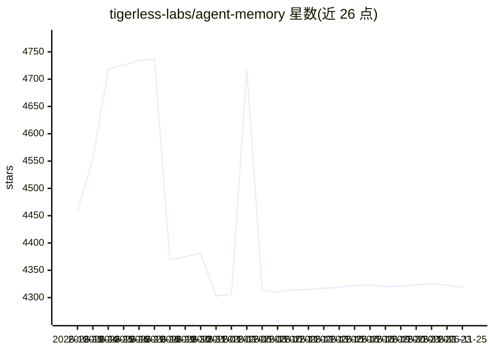

# tigerless-labs/agent-memory

⭐ 4,319 · Python · MIT · 推送 2026-11-12 · [GitHub](https://github.com/tigerless-labs/agent-memory) · 组织维护

**AI agent 的长期记忆运行时：Markdown 为源，本地检索，多宿主共享**

为 AI agent 提供长期记忆运行时：以单个存储中的 Markdown 文件为唯一事实源，SQLite 索引仅为可随时删除重建的缓存。检索在本地完成并排序，返回路径与分级摘要（L0 列表→大纲→全文）而非粘贴文本。写入在会话边界触发蒸馏，独立的 sleep-time Manage 层按自身时钟做合并与按价值遗忘，删除仅以提案形式由用户确认。库内不含 LLM 客户端，无需 API key。面向运行 shell 命令的 agent（Claude Code、Codex CLI、Muse Code、Hermes），需 Python 3.12+ 与 uv，目前未发布 PyPI，仅可从源码安装。

## 筛选速览

| 维度 | 判定 | 备注 |
|---|---|---|
| AI 角色 | `ai-ecosystem` | LLM/agent 周边工具 |
| 许可风险 | `permissive` | MIT |
| 部署形态 | `library` | 以包/库形式分发 |
| 模型依赖 | — | README 未给出锁定关系 |
| 硬件要求 | — | 无带数字的原话,不猜 |
| 安装摩擦 | `low` | 无编译、无系统依赖或容器化 |
| 成熟度 | — | 结构信号不足 |

## 能力要点

- Markdown 文件为事实源，索引可 rm -rf 后 mem rebuild 重建
- 三级读取轨道：MEMORY.md 注入、BM25/FTS5 召回（可选向量插件 RRF 融合）、目录树 ls/grep 兜底
- sleep-time Manage 层：无监督通过只能增改，删除仅为待确认提案；recall --as-of 按日期回溯
- mem setup 一条命令接入 Claude Code/Codex/Muse Code，可经 --mcp 提供 9 个 MCP 工具

## 适用场景

- 给 Claude Code 或 Codex 加上跨会话保留的长期记忆
- 多个 agent 宿主共享同一个记忆存储
- 不想引入 API key 和向量数据库的本地优先记忆方案

## 场景标签

`Agent 记忆` · 领域:Agent 开发

## 证据(README 行号)

> L1: ### agent-memory: the long-term memory runtime for AI agents
> L11: Retrieval is local and ranked, and it answers with paths rather than pasted text — the agent
> L14: forgets by value, on its own clock. None of it needs an API key.

## 星数曲线

2026-10-23 4,459 → 2026-11-25 4,319（-140）

---
*卡片 v1 · prompt 1.4 · 生成 2026-11-22 · 置信度 mid · 依据 README sha `9a512dd9baf2` · [字段定义](../../DATASET.md)*
