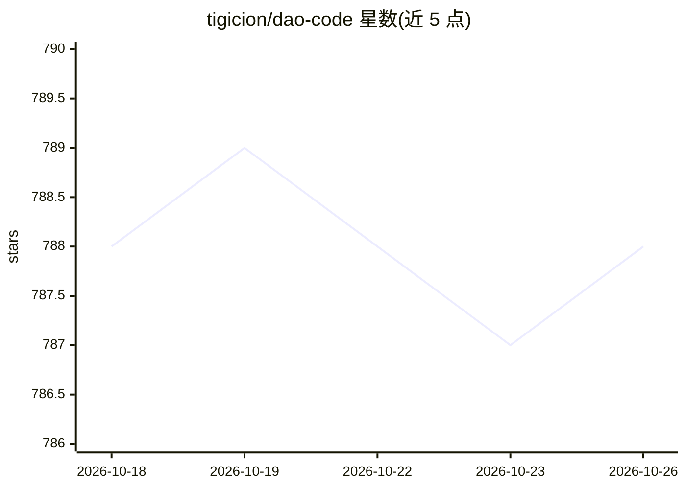

# tigicion/dao-code

⭐ 788 · TypeScript · MIT · 推送 2026-10-21 · [GitHub](https://github.com/tigicion/dao-code) · [官网](https://www.npmjs.com/package/dao-code) · 个人维护 · 中文 README

**面向 DeepSeek V4 的终端 AI 编程助手（命令 dao）**

TypeScript 编写的终端编程 agent：读取/编写代码、运行命令、修复 bug，流式输出推理与工具调用，写入/执行操作经过审批门控。针对 DeepSeek V4（1M 上下文）设计，通过字节稳定前缀与复用缓存的 fork（反思层、跨会话记忆）利用 DeepSeek 前缀缓存降价；提供 24 个工具、Skills、MCP、Hooks、子代理、shadow-git 检查点与自主长任务模式。安装支持一键脚本、npm 与源码，需自备 DeepSeek API key。MIT 许可，中文优先。

## 筛选速览

| 维度 | 判定 | 备注 |
|---|---|---|
| AI 角色 | `ai-native` | 本体是模型或模型工具 |
| 许可风险 | `permissive` | MIT |
| 部署形态 | `desktop` | 安装包/桌面程序 |
| 模型依赖 | locked-api |  |
| 硬件要求 | — | 无带数字的原话,不猜 |
| 安装摩擦 | `low` | 无编译、无系统依赖或容器化 |
| 成熟度 | — | 结构信号不足 |

## 能力要点

- 字节稳定前缀 + 缓存复用 fork 运行反思与记忆，实测 7 任务合计 95.8% 缓存命中率
- 跨会话记忆启动时对当前代码做确定性校验（过期丢弃、变更标记）
- 24 工具、Skills/MCP/Hooks 扩展体系与 shadow-git 检查点（/restore /rewind）
- --goal 自主长任务模式与自动压缩、卡死检测断路器

## 适用场景

- 在终端里让 AI 读改代码、跑测试并自修 bug
- 长任务自主运行且不漂移（自动压缩 + 周期性目标重述）
- 以低成本跑 SWE-bench 式真实仓库修复任务

## 场景标签

`编码 Agent` · 领域:编码与开发

## 证据(README 行号)

> L14: Dao Code (command `dao`) is a terminal-native AI coding assistant: it reads code, writes code, runs commands, and f
> L10: > **A terminal coding agent built around cost, experience, and availability** — squeezing the most capability and t

## 星数曲线

2026-10-18 788 → 2026-10-26 788（+0）

---
*卡片 v1 · prompt 1.4 · 生成 2026-10-21 · 置信度 high · 依据 README sha `02bcec6f690f` · [字段定义](../../DATASET.md)*
