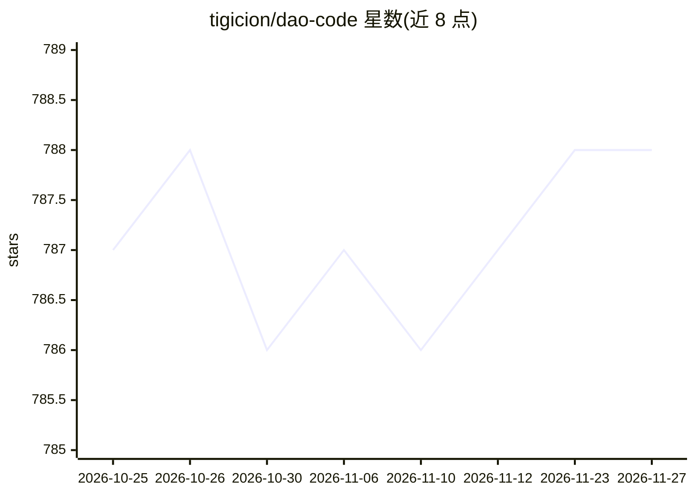

# tigicion/dao-code

⭐ 788 · TypeScript · MIT · 推送 2026-10-28 · [GitHub](https://github.com/tigicion/dao-code) · [官网](https://www.npmjs.com/package/dao-code) · 个人维护 · 中文 README

**面向 DeepSeek V4 的终端编程 Agent，主打低成本缓存**

Dao Code（命令 dao）是运行在终端里的 TypeScript 编码助手：读取代码、修改代码、执行命令、修复 bug，输出经审批门控。围绕 DeepSeek V4（1M 上下文）设计，通过字节稳定的前缀与复用缓存的 fork 运行记忆和反思层以提升缓存命中率；提供跨会话自校验记忆、失败自审、自动压缩、shadow-git 检查点、子 Agent 等机制。MIT 协议，README 称对中国大陆网络环境可直接使用 DeepSeek API。

## 筛选速览

| 维度 | 判定 | 备注 |
|---|---|---|
| AI 角色 | `ai-native` | 本体是模型或模型工具 |
| 许可风险 | `permissive` | MIT |
| 部署形态 | `desktop` | 安装包/桌面程序 |
| 模型依赖 | locked-api |  |
| 硬件要求 | — | 无带数字的原话,不猜 |
| 安装摩擦 | `low` | 无编译、无系统依赖或容器化 |
| 成熟度 | — | 结构信号不足 |

## 能力要点

- 字节稳定前缀 + 缓存复用 fork 的缓存工程，附 /cost 命中率统计
- 跨会话记忆在每次启动时对照当前代码做确定性校验
- Challenger/Refocuser 反思层、自动压缩、shadow-git 检查点与崩溃恢复
- 提供 npm、安装脚本、Release 二进制与源码构建四种获取方式

## 适用场景

- 在终端内让 AI 读取/修改代码并执行命令完成开发任务
- 长时间自主任务中控制成本并防止目标漂移
- 在 DeepSeek API 可直接访问的环境下使用编码 Agent

## 场景标签

`编码 Agent` · 领域:编码与开发

## 证据(README 行号)

> L14: Dao Code (command `dao`) is a terminal-native AI coding assistant: it reads code, writes code, runs commands, and f
> L84: ## 📦 Install
> L124:    dao --api-key sk-xxx --provider deepseek "tell me a joke"

## 星数曲线

2026-10-25 787 → 2026-11-27 788（+1）

---
*卡片 v1 · prompt 1.4 · 生成 2026-11-24 · 置信度 high · 依据 README sha `23b247a3724e` · [字段定义](../../DATASET.md)*
