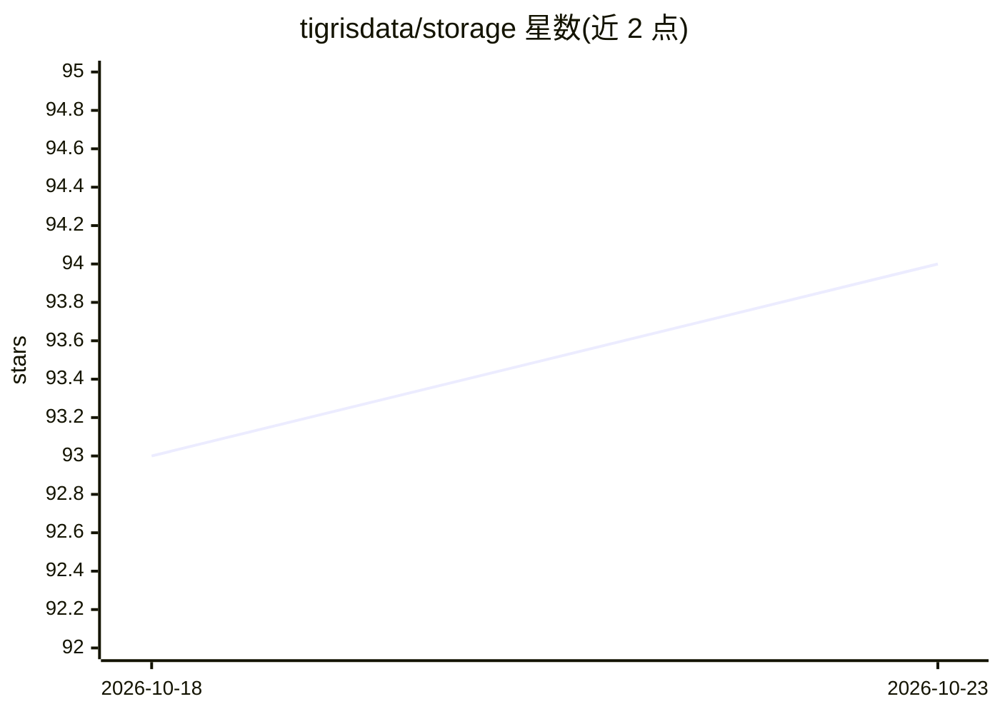

# tigrisdata/storage

⭐ 94 · TypeScript · MIT · 推送 2026-10-22 · [GitHub](https://github.com/tigrisdata/storage) · [官网](https://www.tigrisdata.com) · 组织维护

**Tigris 对象存储的 JavaScript/TypeScript SDK 合集（含 AI agent 工具）**

Tigris 是全球分布式、S3 兼容的对象存储服务，本 monorepo 收录其多个 JavaScript/TypeScript 包：存储 SDK、IAM SDK、CLI、Keyv 适配器、React 组件库，以及面向 AI agent 的组件——agent-kit（沙箱、工作区、检查点、协调的组合工作流）与 agent-shell（由 Tigris 对象存储支撑的虚拟 bash 环境）。另含未发布的 agent-shell playground 应用。Go SDK 在独立仓库维护，可用 go get 安装。面向使用 Tigris 存储服务的开发者。

## 筛选速览

| 维度 | 判定 | 备注 |
|---|---|---|
| AI 角色 | `ai-enhanced` | 去掉 AI 部分产品仍成立 |
| 许可风险 | `permissive` | MIT |
| 部署形态 | `None` |  |
| 模型依赖 | — | README 未给出锁定关系 |
| 硬件要求 | — | 无带数字的原话,不猜 |
| 安装摩擦 | `low` | 无编译、无系统依赖或容器化 |
| 成熟度 | — | 结构信号不足 |

## 能力要点

- S3 兼容的全球分布式对象存储服务 SDK
- 包含 AI agent 组件：agent-kit（沙箱/工作区/检查点/协调）与 agent-shell（虚拟 bash 环境）
- 多包形式：存储/IAM SDK、CLI、Keyv 适配器、React 组件与 Hooks
- Go SDK 在独立仓库 tigrisdata/storage-go 维护

## 适用场景

- 在 JavaScript/TypeScript 应用中接入 Tigris 对象存储
- 为 AI agent 提供沙箱、工作区与虚拟 bash 执行环境
- 通过 CLI 或 React 组件管理对象存储

## 场景标签

 · 领域:云存储/开发者工具

## 证据(README 行号)

> L3: Tigris is a globally distributed object storage service that provides low latency anywhere in the world, enabling de
> L12: - `@tigrisdata/agent-kit` - Composed workflows for AI agents (sandboxes, workspaces, checkpoints, coordination)
> L15: - `@tigrisdata/agent-shell` - A virtual bash environment for AI agents, backed by Tigris object storage

## 星数曲线

2026-10-18 93 → 2026-10-23 94（+1）

---
*卡片 v1 · prompt 1.4 · 生成 2026-10-23 · 置信度 mid · 依据 README sha `d376fdb4df79` · [字段定义](../../DATASET.md)*
