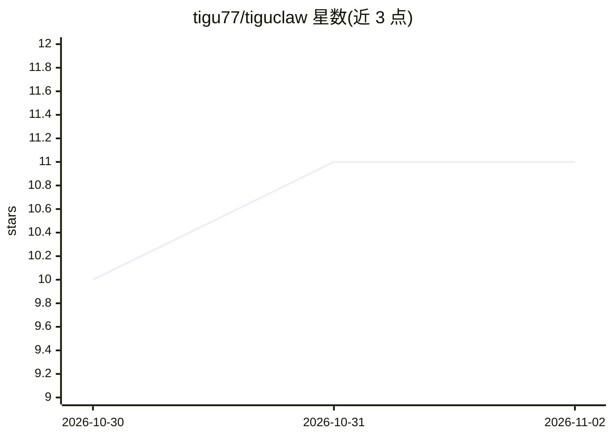

# tigu77/tiguclaw

⭐ 11 · TypeScript · Apache-2.0 · 推送 2026-11-01 · [GitHub](https://github.com/tigu77/tiguclaw) · 个人维护

**自托管常驻个人 AI 助手：一个入口按目标自动组建 agent 组织**

TypeScript 实现的自托管多 LLM agent 运行时：用户只面对一个主助手并陈述目标，由其决定自办或将目标交给 manager，manager 拆解并挂载 sub-agent 收集结果（层级固定为两层，不可再嵌套）。接入 Telegram/CLI/HTTP/Web 仪表盘，会话、记忆与数据库均存于本地 ~/.tiguclaw。支持 Anthropic/OpenAI/Google/Codex 订阅及任意 OpenAI 兼容端点（含本地 Ollama），兼容 Claude Code 的工具、hooks 与技能格式，可读取屏幕并操作，破坏性动作前请求确认。以安装脚本或 git clone 加 onboard 命令安装，需 Node 20+ 与至少一个 LLM 提供方。

## 筛选速览

| 维度 | 判定 | 备注 |
|---|---|---|
| AI 角色 | `ai-native` | 本体是模型或模型工具 |
| 许可风险 | `permissive` | Apache-2.0 |
| 部署形态 | `None` |  |
| 模型依赖 | local-ok | 支持本地模型 |
| 硬件要求 | — | 无带数字的原话,不猜 |
| 安装摩擦 | `low` | 无编译、无系统依赖或容器化 |
| 成熟度 | — | 结构信号不足 |

## 能力要点

- 主助手–manager–sub-agent 两层组织，manager 收齐结果才算完成
- Telegram/CLI/HTTP/Web 仪表盘多通道同一身份共享记忆
- 支持 Anthropic/OpenAI/Google/Codex 及 OpenAI 兼容端点（含 Ollama）跨提供方回退
- 兼容 Claude Code 的工具、settings.json hooks 与技能布局

## 适用场景

- 通过 Telegram 或网页仪表盘常驻使用同一个 AI 助手处理日常目标
- 把大任务整体交给 manager 组建 sub-agent 并行执行并收集结果
- 在本地用 Ollama 等端点自托管个人 AI 助手，数据留在自己机器上

## 场景标签

 · 领域:个人 AI 助手/agent 运行时

## 证据(README 行号)

> L12: tiguclaw is an always-on AI assistant built so that **you only ever talk to one of them**.
> L30: tiguclaw goes the other way. You talk to **one assistant** and state a goal. The organization is
> L180: 2. **Same assistant wherever you come in** — Telegram, CLI, HTTP, web dashboard. One identity, shared

## 星数曲线

2026-10-30 10 → 2026-11-02 11（+1）

---
*卡片 v1 · prompt 1.4 · 生成 2026-11-02 · 置信度 high · 依据 README sha `4c0855388d07` · [字段定义](../../DATASET.md)*
